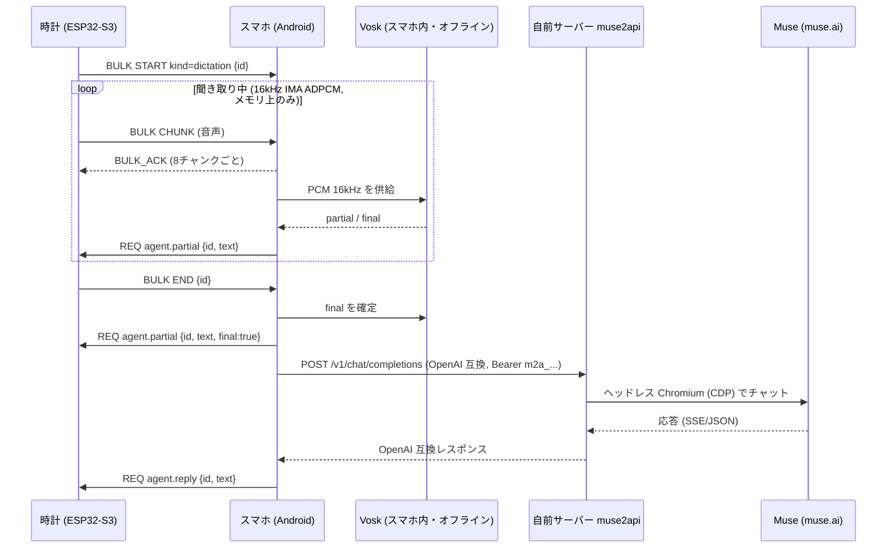

# Muse 連携 + リアルタイム文字起こし (設計・セットアップ)

2026-11-17 開始。SAS-Watch を「使える AI 入力端末」にするための設計。
対象: リアルタイム日本語文字起こし (時計マイク → スマホ → オフライン認識) と、
スマホ経由で **Meta Muse (personal AI agent)** にメッセージを送り応答を時計に出す機能。

> **2026-11-17 方針確定 (ユーザー指示)**: **有料 API は使わない (0 円運用)**。
> そのため当初案の Meta Model API (ASR) と useapi.net (Muse API) は**不採用**。
> 文字起こしは **スマホ内の Vosk オフライン認識**、Muse へは
> **このサーバーに自前で立てる muse2api (MIT, self-hosted, OpenAI 互換)** で接続する。
> 有料案の調査結果は末尾の付録に残す (将来ユーザーが変心した場合用)。

> ステータス: **実装中**。実装状況は `docs/handoff.md` と `docs/roadmap.md` の
> T38〜T44 を正とする。サーバー構築は `docs/muse2api-server.md`。

## 1. なぜこの構成か

- 時計 (ESP32-S3, PSRAM 8MB) 単体で日本語音声認識は現実的でない。→ スマホに中継する。
- 「日本語入力がまだ」の正体は **IME/テキスト入力の不在**。時計の小さい画面で
  日本語を打つより、**話して文字にする (dictation)** 方が実用的。
- AI アプリが弱い → 自前の OpenAI 互換チャットではなく、ユーザーが日常で使う
  **Muse (Meta の personal AI agent)** に直接メッセージを送る。
- **0 円が絶対条件**。クラウドの従量課金は使わず、
  認識はスマホ内 (Vosk)、Muse 接続は自前サーバー (muse2api) で行う。

## 2. 全体構成 (0 円)

- 時計: マイク → ADPCM エンコード → BLE ストリーミング、部分文字起こしの表示、
  応答表示。**認識・LLM は一切しない**。
- **音声は保存しない**: 時計→スマホはメモリ上のストリーミングのみ。スマホは Vosk に
  流した PCM を破棄する (音声ファイル・クラウド保存なし)。時計側の発話上限は
  3 分 (暴走防止の安全弁) で、3 秒などで自動終了しない。
- スマホ: BLE 受信 → ADPCM デコード → **Vosk (アプリ内・オフライン)** →
  部分結果を時計へ → 確定後に **muse2api** へチャット → 応答を時計へ。
  チャット画面 (日本語 IME でテキスト送信も可) を持つ。
- サーバー: `muse2api` (Docker 常駐)。Muse の Web セッション (cookie) を使い、
  OpenAI 互換 `/v1/chat/completions` を提供。**従量課金なし**。
- スマホ⇄サーバー: **Tailscale (tailnet 限定) を既定** にする。
  `https://sas.tail85c8c5.ts.net:8445/v1` (Tailscale Serve, TLS, 0円)。
  自宅 Wi-Fi 内のみの代替として `http://192.168.10.10:18610/v1`。
  **公開トンネルは使わない** (muse.sasnews.dev は撤回済み、現在 404)。

## 3. 採用コンポーネント

### 3.1 Vosk (スマホ内オフライン STT)

- Android ライブラリ: `com.alphacephei:vosk-android` (Apache-2.0)。
- 日本語モデル: `vosk-model-small-ja-0.22` (約 49.7MB, Apache-2.0)。
  初回だけ HTTPS ダウンロード (`https://alphacephei.com/vosk/models/`) →
  アプリ領域に展開して再利用。以降は完全オフライン。
- 16kHz mono PCM を `Recognizer.acceptWaveForm()` に供給し、
  `PartialResult()` → 部分表示、`Result()` → 確定。無音/停止操作で final。
- 制約: クラウド STT より精度は低い (騒音・専門用語に弱い)。
  必要なら後でモデルを差し替えられるよう `SttEngine` インターフェースで抽象化する。

### 3.2 muse2api (サーバー常駐, OpenAI 互換)

- リポジトリ: `czg86389-hub/muse2api` (MIT)。Muse の Web セッションを
  ヘッドレス Chromium (CDP) 経由で操作し、OpenAI 互換 API を提供する。
- 提供エンドポイント: `/v1/models`, `/v1/chat/completions` (SSE ストリーミング可),
  `/v1/images/*`, `/v1/videos/*`, 管理画面 `/admin?key=<MUSE2API_KEY>`。
- 認証: `Authorization: Bearer <MUSE2API_KEY>` (`m2a_...`)。
- Muse のログイン: **cookie を 1 回だけ投入** (PC ブラウザの拡張 or
  `tools/muse2api/import_cookies.py`)。以後は自動更新。
- 運用・注意は `docs/muse2api-server.md` を正とする。
- 非公式ブリッジである: Muse の規約・仕様変更で動かなくなる可能性、
  Muse アカウントの Free プラン週次枠を消費する、サーバーで Chromium が動く。

## 4. 設定 (スマホアプリ)

`設定 → AI設定` に追加する (秘密値は既存の `EncryptedSharedPreferences` に保存し、
画面にはマスク表示)。

| 項目 | 例 | 用途 |
|---|---|---|
| AI バックエンド | `muse2api` / `OpenAI互換` | どちらに繋ぐか |
| Base URL | `http://192.168.10.10:18610/v1` または `https://muse.sasnews.dev/v1` | muse2api / OpenAI互換 |
| API キー | `m2a_...` | muse2api の認証 (旧 OpenAI 互換のキーとは別欄) |
| チャットモデル | `muse-spark` (alias `gpt-5` 等も可) | `/v1/models` の id |
| 音声認識 | `Vosk 日本語 (オフライン)` | STT 方式 |
| Vosk モデル | 未DL / DL済み (49.7MB) | 初回ダウンロード・状態表示 |
| 言語 | `ja` | Vosk モデルで固定 |

時計側の設定は増やさない (`agent.q1..3` はそのまま)。

## 5. フォールバック

1. **Vosk モデル未 DL**: 「設定で音声モデルをダウンロードしてください」を表示。
   聞き取りとテキスト質問は動く (認識だけ不可)。
2. **muse2api 未設定/接続不可**: 従来の OpenAI 互換 `chat/completions` 設定に
   フォールバック (Base URL/キーが入っていれば)。無ければ
   「スマホでAI設定をしてください」。
3. **muse2api に Muse アカウント未接続 (cookie 未投入)**: 401/400 を検知して
   「サーバーに Muse のログイン情報を入れてください」を表示。
4. BLE 切断 / 認識失敗 / HTTP エラーは、時計に日本語の短いエラーを返す。

## 6. セットアップ手順 (ユーザー作業)

詳細は `docs/muse-setup.md` (無料構成版) と `docs/muse2api-server.md`。概要:

1. **サーバー (Lead が構築済み)**: muse2api を Docker で常駐 (port 18610)。
   Tailscale Serve で `https://sas.tail85c8c5.ts.net:8445` に tailnet 限定で公開。
   公開インターネットには出さない。
2. **Muse の cookie を 1 回投入 (ユーザー作業)**:
   - PC の Chrome/Edge で muse.ai にログイン。
   - サーバーの管理画面 `http://192.168.10.10:18610/admin?key=<MUSE2API_KEY>` から
     拡張機能を入れてワンクリックで取り込む、または DevTools の Cookie ヘッダを
     `tools/muse2api/import_cookies.py` に stdin で渡す。
   - **cookie の値は会話・リポジトリ・チャットに書かない**。
3. **スマホ**: Tailscale アプリを入れ、サーバーと同じ tailnet に参加
   (サーバー名 `sas` / 100.69.94.109)。APK を入れ、設定で
   Base URL `https://sas.tail85c8c5.ts.net:8445/v1` と API キーを入力、
   Vosk モデルをダウンロード。
4. **時計**: AI 画面で「話しかける」→ 日本語で話す → 部分文字起こし →
   停止 → Muse の返答。

## 7. 検証

| 対象 | 方法 |
|---|---|
| core | `cmake -S core -B core/build && cmake --build core/build && ctest --test-dir core/build` (dictation の BULK 組み立て、agent.partial の状態遷移) |
| Android (純 Kotlin) | `cd android && ./gradlew :protocol:test :agent:test` (ADPCM、Vosk 結果パーサ、SSE/JSON、ルーティング) |
| Android アプリ | `./gradlew :app:assembleDebug :app:lint` |
| サーバー | `curl -H "Authorization: Bearer $MUSE2API_KEY" .../v1/models`、`/v1/chat/completions` (cookie 投入後)、管理画面認証、再起動後の永続化 |
| sim | 部分文字起こし表示の snapshot (聞き取り中 partial / 確定 / エラー)、監査 0 件 |
| 実機 | 時計→スマホの dictation スループット (目標 8KB/s を 5 秒以上)、部分表示の遅延 (目標 1〜2 秒)、Muse 応答の往復 |

## 8. 未解決・リスク

- **BLE スループット**: ADPCM 16kHz = 8KB/s。MTU 247 / 232B で ~35 通知/秒。
  接続インターバル 15〜30ms + 2M PHY を dictation 中だけ要求し、終了で戻す実装。
  実機計測が必要。不足時は 8kHz (4KB/s) フォールバックを検討。
- **Vosk の精度**: クラウドより低い。騒音・固有名詞に弱い。
  `SttEngine` を差し替え可能にして将来改善。
- **muse2api の非公式性**: Muse の Web UI 変更・規約変更で壊れうる。
  cookie セッションが切れたら再投入が必要。Free プランの週次枠に依存。
- **サーバー公開範囲**: **公開インターネットには出さない** (Tailscale tailnet 限定)。
  `/v1` は API キーでも保護。管理画面 (`/admin`) は tailnet 内 PC または LAN から。
  公開トンネル案はリスク判断で撤回済み (`docs/muse2api-server.md`)。
- **プライバシー**: 音声はスマホ内で処理 (クラウドに送らない)。テキストだけ
  muse2api 経由で Muse に送られる。
- **Muse の応答長**: 時計の `agent.reply` は 960B 上限。スマホ側で要約/切り詰め。
- **Muse の許可要求 (approval)**: 時計では承認できない。
  v1 は「スマホのチャット画面で承認」に誘導する。

---

## 付録: 不採用の有料案 (調査結果, 2026-11-17)

0 円条件が出る前に調査した案。将来ユーザーが課金を許容した場合の参考。

### A. Meta Model API (Muse Voice Transcribe) — ASR
- リアルタイム `wss://api.meta.ai/v1/asr/realtime`、`PCM_16KHZ`、
  `languageBias:["Japanese"]`、partial/final、$0.18/時間 (無料枠なし、要支払い方法)。
- ファイル `POST /v1/asr/transcribe` (WAV 16k/24k, 10分/32MB)。
- 精度は Vosk より高い。実装は `android/agent` に `Asr.kt` として残置 (オプション)。

### B. useapi.net Muse API — Muse エージェント直結
- $15/月 + Muse 本体プラン。`POST /v1/muse/chats/{chatId}/messages` と
  `GET .../stream` (SSE)。Muse の personal agent の記憶/コネクタに繋がる。
- 公式 API は無い。実装は `android/agent` に `Muse.kt` として残置 (オプション)。
- セットアップ: `docs/muse-setup.md` の付録、スモーク: `tools/muse_smoke/`。
