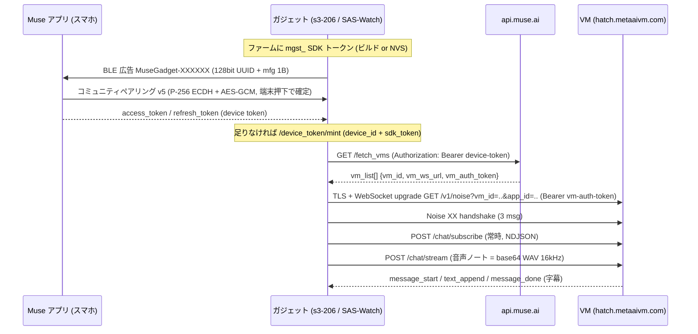
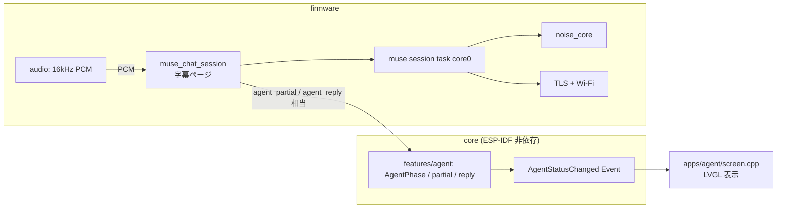

# Muse Gadget SDK の「Muse と話す」層を SAS-Watch ファームへ統合できるか (T47 調査・設計)

2026-11-18。**調査・設計のみ。実装コードは書いていない。**
SAS-Watch への書き込みはこのファイルだけ (firmware/core/android/docs は未変更)。

対象 SDK: `facebookincubator/muse-gadget-sdk` pinned **`ec976f0`** (Apache-2.0)。
ローカルミラー `/home/sasnews/deepseek-harness/default-workspace/.toolchain/muse-gadget-sdk` (読み取り専用)。
本調査は T46 (`muse-gadget-build`) が同じミラーで作った **s3-206 実ビルドの map / ログ**を実測値として使わせてもらった。

> 前提: SAS-Watch の実機は SDK が `s3-206` として**公式サポートしているのと同じ基板**
> (`Waveshare ESP32-S3-Touch-AMOLED-2.06`, `esp32/devices/waveshare-s3-206.md:17-22`)。
> したがって「基板が違うから動かない」という障壁は無い。問題はソフトウェアの資格情報・RAM・省電力・保守。

---

## 0. 結論 (先に読む)

| 論点 | 結論 |
|---|---|
| 音声 (24kHz 前提か) | **問題にならない**。SDK の既定経路は **16kHz PCM16 mono の音声ノート**を `/chat/stream` に送る。24kHz は `/api/voice/dictation` とリアルタイム通話だけ。SAS-Watch の 16kHz 録音はそのまま使える (`muse_chat_session.cpp:101-103,149-156`) |
| TTS | 不要。SDK の既定は「返答はテキスト字幕のみ」で、`start_tts` は**フックのコメントだけ** (`muse_chat_session.cpp:1976-2007`)。スピーカー無効の SAS-Watch はまさに既定動作 |
| IDF 6.0.3 依存 | **チャット/Noise 層は 5.5.1 のままでビルドできる見込み**(ヘッダ差分はペアリング層の 3 本のみ、PSA crypto は 5.5.1 でも有効)。IDF6 移行は不要 |
| 本当の壁 | **(1) 資格情報**: VM のトークンは Muse アプリとの BLE ペアリングでしか手に入らない。`mgst_` SDK トークン単体では VM の API を叩けない。**(2) 内蔵 SRAM / PSRAM**: 2 本目の TLS+Noise は素の設定だと PSRAM 1.2MB 超・TLS の内部 RAM 30〜50KB を要求。**(3) Wi-Fi 常時接続の電池**(SAS-Watch は未計測) |
| 推奨 | **C (現行スマホ+muse2api) を維持**。まず **A (公式ファームを別ファームとして試す)** を実機で試して「Muse 直結の体験」とアカウント可用性を確認。**B は「トークンを外部から用意できるか」のスパイク (M1) が通ったときだけ**、最小構成 (B-min) で 4〜7 人日。ペアリング移植 (B-full) は +5〜8 人日で**当面やらない** |
| 最初の一歩 | **M0: 公式ファームを別ファームで試す**(ビルドは T46 が完了済み、`muse-gadget.bin` 3,411,968B)。フラッシュ全量バックアップ → 書き込み → Muse アプリ (Developer mode) でペアリング → 日本語で話して字幕を確認 → 元に戻す |

**「やるならこの順」**: M0 (試す) → M1 (資格情報スパイク) → ここで GO/NO-GO → B1 (トランスポート) → B2 (UI) → (必要なら) B3 (ペアリング)。§9.4 に受け入れ条件つきで書いた。

---

## 1. 調査対象と SAS-Watch の現状

### 1.1 SDK 側

| 項目 | 値 | 根拠 |
|---|---|---|
| ライセンス | Apache-2.0 | `LICENSE` |
| pinned commit | `ec976f0` | ミラー |
| 必要 IDF | **v6.0.3** (他は非対応) | `esp32/README.md:86-108`, `esp32/AGENTS.md:30-37` |
| LVGL | 9.5.0 (managed) | `esp32/components/muse/idf_component.yml` |
| 対応基板 | `s3-206` = SAS-Watch と同一 | `esp32/devices/waveshare-s3-206.md:17-22` |
| 構成 | `main/` = Home Link (BLE セットアップ, Wi-Fi, Noise セッション, VM, トンネル, OTA) / `components/muse` = UI・音声・chat / `components/noise_core` = Noise XX | `esp32/main/CMakeLists.txt:19-72` |

### 1.2 SAS-Watch 側 (現状)

| 項目 | 値 | 根拠 |
|---|---|---|
| IDF / LVGL / BLE | 5.5.1 / 9.5.0 / NimBLE (peripheral, bond 必須) | `docs/handoff.md:222` |
| flash / app | 32MB / app 4MB×2 (空き 47.9%, 2,010,320B) | `firmware/partitions.csv`, `docs/lightweight.md:160-170` |
| 内蔵 SRAM | 静的 321,271B (空き 20,489B) / 実行時 `int_free` 18〜21KB | `docs/lightweight.md:186-199` |
| PSRAM | standard ~3.4MB / 肌テーマ ~750KB (最大連続 ~500KB) / mame ~450KB | `docs/handoff.md:165` |
| マイク | ES7210 経由 16kHz 16bit PCM → IMA ADPCM。**16kHz 固定** | `core/include/watch/adpcm.hpp:20`, `firmware/components/audio/src/audio.cpp:2-5,307-311` |
| スピーカー | **無効** (`# CONFIG_WATCH_ENABLE_SPEAKER is not set`) | `firmware/sdkconfig:2544-2545` |
| Wi-Fi | コンポーネントあり (`wifi::session_start/end`)。**OTA 時だけ**起動 | `firmware/components/wifi/src/wifi.cpp:1-5`, `firmware/components/ota/src/ota.cpp:118,159` |
| AI 画面 | core の `AgentPhase` (Idle/Recording/Sending/Thinking/Reply/Error) を UI が表示するだけ | `core/include/watch/features/agent.hpp:37-45`, `apps/agent/screen.cpp:40-160` |
| 返答/部分文字起こし上限 | 960B / 768B | `core/include/watch/features/agent.hpp:21-22` |
| 日本語表示 | assets の binfont (jp_20/26/32) を PSRAM 常駐 | `docs/handoff.md:101-105` |

---

## 2. SDK の構造と SAS-Watch との対応 (再利用できるもの/できないもの)

| 役割 | SDK の実装 | SAS-Watch の既存 | 判定 |
|---|---|---|---|
| 基板 (パネル/タッチ/PMU/IMU/RTC) | `components/muse/boards/board_waveshare_s3_206.c` + Waveshare BSP + `muse_lcd_bands.c` | `vendor/esp32_s3_touch_amoled_2_06` (パッチ済み) + `vendor/esp_lvgl_port` | **SDK 側は使わない** (SAS-Watch のパッチ済み BSP を維持) |
| 音声 (codec/I2S) | `components/muse/muse_audio.c` (16kHz 2slot→mono) | `firmware/components/audio/src/audio.cpp` (16kHz mono→ADPCM) | **SDK 側は使わない**。PCM を渡すだけの薄いアダプタを書く |
| Wi-Fi | `main/wifi_mgr.c` (常時接続・スキャン・既知 AP) | `components/wifi` (接続/切断のみ) | **SAS-Watch のものを使う** (常時接続ポリシーだけ足す) |
| BLE セットアップ (Muse アプリ) | `main/ble_server.c` + `main/link_pairing.c` | `components/ble_link` (独自 ctrl/event/bulk, ボンド必須) | **共存は可能**だがペアリング移植は高コスト (§4) |
| Noise トランスポート | `components/noise_core` (Noise_XX_25519_AESGCM_SHA256) | 無し | **そのまま流用候補** (§6) |
| Muse chat | `components/muse/muse_chat*` (session/link/text) | 無し (スマホ側で muse2api) | **流用候補** (§5) |
| アカウント/VM | `components/muse/muse_account_api.c` + `main/vm_api.c` | 無し | 流用候補 (fetch_vms のみ) |
| UI/字幕 | `components/muse/muse_ui.c` ほか 19 ファイル + CJK フォント 1.2MB | `apps/agent` + 日本語 binfont | **SDK UI は使わない**。字幕だけ SAS-Watch の UI へ |
| トンネル/コマンド/OTA/WASM/ビデオ | `main/noise_tunnel.cpp`, `app.c`, `ota.c`, `muse_apps`, `muse_video*` | — | 今回の目的には**不要** (これらを落とせるかが工数の分かれ目) |

規模感 (行数, `wc -l`): `main/` の転送・ペアリング系 ≈ 11,600 行、chat 系 ≈ 6,100 行、`noise_core` 6,739 行。
「Muse と話す」だけでも、製品の Link 層 (ペアリング/VM/tunnel) をまるごと持ってくるか、
**voice session (chat 専用の TLS+Noise) だけを切り出すか**で工数が 2 倍以上変わる (§9)。

---

## 3. 論点 1: Muse 側の通信要件

### 3.1 全体像 (SDK 実装ベース)



### 3.2 根拠 (ファイル/行)

| 段階 | 実装 | 根拠 |
|---|---|---|
| SDK トークン (`mgst_…`) | ビルド時 `CONFIG_GADGET_SDK_TOKEN` か NVS (`>sdk_token=`)。**識別子であってパスワードではない** | `esp32/README.md:111-124,441-444`, `main/sdk_token_console.c`, `main/identity.c:73-110` |
| ペアリング | コミュニティペアリング **v5**、製造者証明なし、端末の明示押下が必要 | `esp32/AGENTS.md:517-525`, `esp32/README.md:149-160` |
| ペアリングの暗号 | P-256 ECDH + AES-GCM、`mbedtls/private/gcm.h` と ESP ECDSA PSA ドライバを使用 | `main/link_pairing.c:24-34,36-55` |
| SDK トークンの使い道 | **ペアリング時に暗号化チャネルで渡す**。あるいは device token の mint/refresh の body に入れる | `main/link_pairing.h:24-29`, `main/vm_api.c:33-36,230-238,393-420` |
| device token | アプリが `access_token`/`refresh_token` を渡し、無ければ `/device_token/mint` で作る | `main/app.c:849-899` |
| VM 一覧 | `GET https://api.muse.ai/fetch_vms` + `X-API-Version: 1.0.0`。応答 `vm_list[].vm_id/vm_ws_url/vm_auth_token` | `components/muse/muse_account_api.c:33,54-80,102-174` |
| VM WebSocket | `GET /v1/noise?vm_id=..`。`Authorization: Bearer <vm_auth_token>` (ヘッダで渡し URL に出さない) | `components/muse/muse_chat_session.cpp:97-98,578-604` |
| Noise | `Noise_XX_25519_AESGCM_SHA256`。msg3 の payload は空 protobuf | `components/noise_core/src/InitiatorHandshake.cpp:27`, `muse_chat_session.cpp:649-681` |
| サブスクリプション | 接続直後に `POST /chat/subscribe` (`{}`, NDJSON) を張りっぱなし | `muse_chat_session.cpp:871-881` |
| 送信 (音声) | `POST /chat/stream`。body = JSON ヘッダ + `data_base64` の WAV (16kHz mono) + 末尾 | `components/muse/muse_chat_priv.h:79-87`, `muse_chat_session.cpp:1200-1230` |
| 送信 (テキスト) | 同じ `/chat/stream` に JSON | `muse_chat_session.cpp:1270-1290` |
| ダイジェスト | 接続先ホスト既定 `hatch.metaaivm.com`。`app_id` は通話時のみ | `muse_chat_session.cpp:960`, `:586-594` |

### 3.3 重要な事実: 「/api/voice/dictation」は現状使われていない

`muse_chat_session.cpp:149-156`:

```c
/*
 * The VM's streaming dictation has no ASR behind it right now, so each press
 * goes to the chat as a voice note, the way the phone app sends them, and the
 * server transcribes it. Set to 0 to stream to /api/voice/dictation instead.
 */
#define VOICE_NOTE 1
```

- 既定は **音声ノート (base64 WAV 16kHz) を `/chat/stream` に送る**。VM 側で文字起こし + 応答。
- `/api/voice/dictation?sample_rate_hz=24000` のコードは残っているが、**サーバ側に ASR が無いので使っていない** (`:1120`)。
- `/voice/realtime` (ライブ通話) は 2026-11-09 に **HTTP 404** の報告があり、SDK 側も「VM が資格情報に対して通話を受け付ける必要がある」と明記 (`components/muse/Kconfig:505-508`)。**通話は設計に入れない**。

→ **SAS-Watch に必要なのは「16kHz PCM16 mono を WAV にして送る」だけ**。ADPCM→PCM のデコードは `core/adpcm.hpp` に既にある。リサンプル不要 (§5)。

---

## 4. 論点 2: BLE ペアリングと既存 NimBLE の共存

### 4.1 Muse アプリ側の要件 (UX の制約)

1. Muse アプリ **Settings > Devices > Developer mode** を ON
2. **Add Device** (+ アイコン) → `MuseGadget-XXXXXX` を選択
3. 端末側の**明示押下**で確定 (uGUI は「押すか、画面のコードを入力」)
4. コミュニティ機器なので**製造者検証なし**、能動的 MITM は防げない
5. 5 秒長押しでセットアップリセット (アンペア)

根拠: `esp32/README.md:149-160`, `esp32/AGENTS.md:517-525`, `esp32/README.md:174-181`。

### 4.2 実装の事実

| 項目 | SDK | 根拠 |
|---|---|---|
| 広告 | flags + **128bit サービス UUID `7fdd3d1c-38ea-46cf-8b46-314ecf5f240c`** + mfg data (0xFFFF + paired フラグ 1B)。名前は scan response | `main/ble_server.c:55-58,933-990` |
| 特性 | RX `4d593029-…` / TX `d75dc4ca-…`、3B ヘッダ + 160B チャンク、最大 8192B | `main/ble_server.c:59-70` |
| SMP | **使わない** (アプリは BLE ボンドしない。暗号は独自トランスクリプト) | `components/muse/muse_ble.c:282-286` (コメント), `main/ble_server.c` に `sm_io_cap` 無し |
| 別サービス | 設定用の `4d757365-…` (Muse の CMD/STATUS) は SMP bond + passkey (DISPLAY_ONLY) | `components/muse/muse_ble.c:43-56,265-275,308-316` |
| ペアリング状態 | `PAIRING_CONFIRM_REQUIRED` を BLE で通知し、端末押下を待つ | `main/ble_server.c:362-376`, `main/app.c:246-272` |
| セッション | ペアリング後は VM への Noise セッションが主。BLE はセットアップ時のみ | `esp32/AGENTS.md:850-858` |

### 4.3 SAS-Watch 側との衝突点と対策

| 衝突 | 内容 | 対策 |
|---|---|---|
| **広告の 31B 上限** | SAS-Watch は flags(3) + 自前 128bit UUID(18) = 21B + scan response に名前 (`ble_link.cpp:425-450`)。Muse の UUID を足すと 39B で入らない | adv には Muse UUID を出し、**SAS-Watch UUID を scan response 側**へ。または「Muse モード中だけ広告を切り替える」。Muse アプリは mfg data と UUID を見るので UUID は adv 側が必須 |
| **端末名** | SAS-Watch は `SAS-Watch-XXXX` を GAP 名に設定 (`ble_link.cpp:431-436`)。Muse は `MuseGadget-XXXXXX` 想定 | 名前は scan response なので、Muse モード中は `MuseGadget-XXXXXX` に差し替える (identity は MAC 下位 3B で作れる: `main/identity.c:58-80`) |
| **接続本数** | SAS-Watch は `CONFIG_BT_NIMBLE_MAX_CONNECTIONS=1` (`firmware/sdkconfig:683`) | 同時接続は 1 本で十分 (ペアリングは一時的、通常は電話アプリか Muse アプリのどちらか)。**排他制御**を UI で持つ |
| **セキュリティフラグ** | SAS-Watch の ctrl/bulk は `WRITE_AUTHEN` (ボンド済み MITM 必須, `ble_link.cpp:372-405`)。Muse の RX/TX は**非ボンドで書ける必要**がある | サービスごとにフラグを分ける (NimBLE は特性単位で指定できる)。同一 GATT DB に 2 サービスを載せるだけなので技術的には共存可能 |
| **NVS** | ボンドは NimBLE の `nimble_bond` NS (`muse_ble.c:372-374`)、SAS-Watch は自前 NVS | 名前空間が分かれるので競合しない |
| **5 秒長押し** | Muse のセットアップリセットは 5 秒長押し。SAS-Watch の PWR 長押しは `power_menu` (`core/src/input_mapper.cpp:76`) | PWR 長押しは SAS-Watch の電源メニューを優先し、Muse リセットは**設定画面の項目**にする (ジェスチャ衝突を避ける) |
| **パスキー表示** | Muse の community pairing は端末押下/コード確認。SAS-Watch は画面あり | 画面に名前と確認 UI を出せるので UX はむしろ有利 |

**判定**: 技術的には共存可能。ただし必要なのは「BLE サービスを 1 本足す」ことではなく、
**ペアリングプロトコル (1,075 行) + アカウント処理 (app.c の該当部) + VM トークン保存**を移植すること。
`link_pairing.c` は IDF6 専用 API を使っており (§6)、5.5.1 では書き直しになる。

---

## 5. 論点 3: 音声経路 — 16kHz で足りる

### 5.1 SDK の音声仕様

| 項目 | 値 | 根拠 |
|---|---|---|
| マイク (SDK 内部) | 16kHz / 16bit / 2 slot → mono にミックス、DC 除去 | `components/muse/muse_audio.h:24-31`, `muse_audio.c` |
| 送信 (既定) | **16kHz PCM16 mono** を WAV にして base64、`/chat/stream` の `data_base64` | `muse_chat_priv.h:81-87`, `muse_chat_session.cpp:1200-1230` |
| 音声ノートの長さ | 20 秒バッファ、Muse は **15 秒**で打ち切り。0.3 秒未満はエラー | `muse_chat_session.cpp:155`, `:1240-1260` |
| 送信の別経路 | 24kHz。ただし `VOICE_NOTE=0` のときだけ (§3.3) | `muse_chat_session.cpp:101-103,1120` |
| 受信 (返答音声) | 16kHz mono。MP3 を minimp3 でデコード | `muse_chat.h:140-144`, `muse_chat_session.cpp:2070-2120` |
| 既定の返答 | **音声なし**: 字幕を読み速度 (16 文字/秒) で流す。TTS はフックのみ | `muse_chat_session.cpp:1976-2010`, `:129-131` |
| 通話 | 16kHz マイク → ワイヤ 24kHz。**今回対象外 (404 報告)** | `muse_voice_call.h:34-35`, `Kconfig:491-508` |

### 5.2 SAS-Watch との突き合わせ

| 項目 | SAS-Watch | 必要な変換 | 判定 |
|---|---|---|---|
| マイク | 16kHz 16bit mono (ES7210) | そのまま | ✅ |
| 保存形式 | IMA ADPCM (4bit) `core/include/watch/adpcm.hpp:20,29-33` | デコード → PCM16 (既存デコーダ) | ✅ |
| チャンク | BLE 8KB/s, `kAgentPumpMs=20ms` | 20ms=320 サンプルずつ喰わせる | ✅ |
| 上限 | 180 秒 (`agent.hpp:19`) | Muse は 15 秒で切るので、UI に「15 秒まで」を出すか、15 秒で自動停止 | ⚠ 仕様差 |
| 操作 | トグル (開始→停止して送信) | SDK は押している間 (600ms 以上)。**SAS-Watch のトグルに合わせる**には「停止時に送信」にする | ⚠ 実装で吸収 |
| スピーカー | 無効 | 返答音声は捨て、字幕のみ | ✅ (SDK の既定と同じ) |
| 24kHz | 不要 | — | ✅ リサンプル不要 |
| minimp3 | 不要 (音声再生しない) | 19,390B を削れる | ✅ |

**結論**: 音声は「16kHz PCM16 mono を WAV ヘッダ付きで base64」にするだけ。
SAS-Watch の録音経路 (16kHz ADPCM) と**同じサンプルレート**なので、リサンプラ (`muse_chat_session.cpp:989-1000`, 線形補間 30 行) すら不要。
2 マイク/ES7210 前提というのも「モノラルにミックスして送る」という意味で、SDK の board 実装の話であり、SAS-Watch のモノラル取得で問題ない。

---

## 6. 論点 4: IDF 6.0.3 依存 — チャット層は 5.5.1 でビルドできる見込み

### 6.1 事実

- SDK は **v6.0.3 のみ**をサポート (`esp32/README.md:86-108`, `esp32/AGENTS.md:30-37`)。
- IDF6.0.3 の mbedTLS は **4.1.1**(`esp-idf-v6.0.3/components/mbedtls/mbedtls` サブモジュール)。SAS-Watch の 5.5.1 は **3.6.4**。
  → mbedTLS 4 では `mbedtls/gcm.h` が公開ヘッダから消え、`mbedtls/private/gcm.h` になる。PSA が唯一の暗号 API。

### 6.2 ヘッダ差分の実測 (対象ファイルの include を両 IDF で照合)

| IDF6 にしか無いヘッダ | 使っているファイル | 影響 |
|---|---|---|
| `mbedtls/private/gcm.h` | `main/link_pairing.c:31` | ペアリング層のみ |
| `psa_crypto_driver_esp_ecdsa.h` | `main/link_pairing.c:32` | 同上 |
| `psa_crypto_driver_esp_ecdsa_contexts.h` | `main/link_pairing.c:33` | 同上 |

`components/noise_core/`, `main/{noise_control,noise_tunnel,vm_api,wifi_mgr,config_store,identity,link_events}.c*`,
`components/muse` の chat 系は **5.5.1 のヘッダで揃う** (差分 0)。
`gcm.h`/`gpio_ll.h` を直接使うのは上記のペアリング層だけ (`gpio_ll.h` は chat 層に無し)。

### 6.3 5.5.1 で成立する根拠

| 項目 | 事実 | 根拠 |
|---|---|---|
| Noise の暗号 | `Noise_XX_25519_AESGCM_SHA256`。PSA で X25519 ECDH / AES-GCM / HMAC-SHA256 を使用 | `InitiatorHandshake.cpp:27`, `PsaCryptoBackend.cpp:193-225` |
| IDF5.5.1 の PSA | `MBEDTLS_PSA_CRYPTO_C` は既定で有効。`PSA_WANT_ALG_GCM` / `PSA_WANT_ECC_MONTGOMERY_255` は legacy 設定から自動導出 | `.toolchain/esp-idf/components/mbedtls/mbedtls/include/mbedtls/mbedtls_config.h:3299`, `config_adjust_psa_from_legacy.h:114,310` |
| SAS-Watch の mbedTLS 設定 | `CONFIG_MBEDTLS_GCM_C=1`, `CONFIG_MBEDTLS_ECP_DP_CURVE25519_ENABLED=1` (build の `config/sdkconfig.h` で実測) | `firmware/build/config/sdkconfig.h` |
| PSA シンボル | `psa_crypto_init` は `libmbedcrypto.a` に存在 (現在は未リンク) | `nm firmware/build/esp-idf/mbedtls/mbedtls/library/libmbedcrypto.a` |
| FreeRTOS/idf_additions | `xTaskCreatePinnedToCoreWithCaps` / `xQueueCreateWithCaps` / `xStreamBufferCreateWithCaps` は 5.5.1 に存在 | `.toolchain/esp-idf/components/freertos/esp_additions/include/freertos/idf_additions.h:284,372` |
| esp-tls | `esp_tls_get_conn_sockfd` は 5.5.1 に存在 | `esp-idf/components/esp-tls/esp_tls.h:554` |
| C++ 規約 | noise_core は `-fno-exceptions -fno-rtti` / C++17。SAS-Watch の規約と同一 | `noise_core/CMakeLists.txt:28-32`, `AGENTS.md:26` |

**残る 5.5.1 側の作業**: cJSON コンポーネントの追加 (`espressif/cjson ~1.7`)、PSA のリンク (推定 +25〜35KB)、
`mbedtls` のメモリ割当を PSRAM 側へ (§7.3)。**IDF6 へ上げる必要はない。**

### 6.4 逆に IDF6 へ上げる場合のコスト (参考)

| 対象 | 内容 | 見積り |
|---|---|---|
| `vendor/esp_lvgl_port` 2.9.0 (パッチ済み) | esp_lcd API / LVGL ポートの IDF6 対応検証。パッチ (SPI ISR core1 固定・タッチ専用タスク) の再検証 | 3〜5 日 |
| `vendor/esp_lcd_sh8601` / BSP 2.0.0 | BSP は `idf_version >=6.0` で `usb ^1.0` に切り替わる定義あり (`vendor/esp32_s3_touch_amoled_2_06/idf_component.yml:11-18`) だが、実機検証が必要 | 2〜3 日 |
| mbedTLS 3.6 → 4.1 | `gcm.h` 系の書き換え。直接 mbedtls を使う自前コードの棚卸し | 1〜2 日 |
| NimBLE / sdkconfig rename | IDF6 のコンポーネント分割・設定名変更の追随 | 1〜2 日 |
| 描画・性能 | AGENTS のルールどおり `b` ベンチの before/after を全テーマで取り直し | 2〜3 日 |
| 合計 | — | **9〜15 人日 + 実機検証** |

**結論**: B (移植) のために IDF6 へ上げるのは割に合わない。5.5.1 のまま chat 層だけ載せる。

---

## 7. 論点 5: メモリ / flash 予算

### 7.1 実測: T46 の公式ビルド (`build-muse-waveshare-s3-206`, IDF v6.0.3, CJK フォント ON, 通話 OFF)

| 指標 | 値 | 根拠 |
|---|---|---|
| `muse-gadget.bin` | **3,411,968B (0x341000)** / app 4MB → **空き 782,336B (19%)** | `build-muse-waveshare-s3-206/log/idf_py_stdout_output_64:2706` |
| DIRAM (静的) | 169,001 / 341,760 (空き 172,759) | `idf_size.py` (同 map) |
| External RAM (静的 PSRAM) | 25,756B | 同上 |
| `.rodata` | 1,674,288B | 同上 |
| Flash Code | 1,581,196B | 同上 |

内訳 (per-object, `idf_size.py --files`):

| オブジェクト | 合計 | .text | .rodata | DIRAM | External RAM |
|---|---:|---:|---:|---:|---:|
| `libmuse.a` 全体 | 1,431,728 | 131,049 | 1,259,049 | 28,234 | 11,336 |
| └ `muse_font_cjk_16.c.obj` (CJK フォント) | 1,232,753 | 0 | 1,232,753 | 0 | 0 |
| └ `muse_chat_session.cpp.obj` | 34,214 | 20,734 | 578 | 1,566 | **11,336** |
| └ `muse_pixel.c.obj` (アバター) | 30,496 | 17,828 | 512 | 12,156 | 0 |
| └ `muse_ui.c.obj` | 19,421 | 18,329 | 95 | 997 | 0 |
| └ `muse_settings_ui.c.obj` | 16,590 | 15,339 | 160 | 1,091 | 0 |
| └ `muse_audio.c.obj` | 11,497 | 5,296 | 92 | 6,109 | 0 |
| └ `muse_voice.c.obj` | 10,542 | 8,039 | 640 | 1,863 | 0 |
| └ `muse_ble.c.obj` | 2,922 | 2,515 | 107 | 300 | 0 |
| └ `muse_settings.c.obj` | 3,297 | 2,006 | 19 | 1,272 | 0 |
| └ `muse_state.c.obj` | 2,980 | 1,958 | 0 | 1,022 | 0 |
| └ `muse_chat_text.c.obj` | 2,247 | 2,170 | 65 | 12 | 0 |
| └ `muse_account_api.c.obj` | 1,207 | 1,207 | 0 | 0 | 0 |
| └ `muse_chat.c.obj` | 662 | 538 | 0 | 124 | 0 |
| `libnoise_core.a` 全体 | 24,450 | 24,367 | 82 | 1 | 0 |
| `libminimp3.a` | 19,390 | 11,850 | 7,540 | 0 | 0 |
| `libespressif__cjson.a` | 6,515 | 6,495 | 0 | 20 | 0 |
| PSA (`psa_crypto.c` + drivers, IDF6) | ≈ 21,000 | ≈ 21,000 | — | — | — |

> 「Muse 層 ≈ 1.43MB」の実体は **CJK フォント 1.23MB**。SAS-Watch は assets の binfont を
> PSRAM に常駐させ既に日本語を描ける (`docs/handoff.md:101-105`) ので、**この 1.2MB は不要**。

### 7.2 SAS-Watch へ載せる場合の見積り (chat 専用サブセット)

| 項目 | 見積り | 根拠 |
|---|---|---|
| flash (code+rodata) | **+90〜110KB** | chat 系 30,176B + noise_core 24,449B + cJSON 6,515B + PSA 25〜35KB + アダプタ/タスク/設定 10〜20KB |
| app への影響 | 2,183,984 → 約 2.29MB / 4MB (空き ~46%) | 問題なし (T43 で 47.9% 空けた) |
| DIRAM (静的) | +4〜6KB | chat 系 DIRAM 計 4,024B + タスク/キューハンドル/ハンドラ |
| External RAM (静的) | +11.3KB | `muse_chat_session.cpp.obj` の PSRAM .bss |
| PSRAM (動的・接続中) | **素の実装 830KB〜1.3MB → チューニング後 200〜270KB** | §7.3 |
| 内蔵 SRAM (実行時ピーク) | **TLS 次第。素の設定では足りない** → §7.3 | — |

### 7.3 メモリの本当の壁 (2 つ)

**(a) 内蔵 SRAM と TLS**

- SAS-Watch は `CONFIG_MBEDTLS_INTERNAL_MEM_ALLOC=y` (`firmware/sdkconfig:2127`)、
  `CONFIG_MBEDTLS_SSL_IN_CONTENT_LEN=16384` / `OUT=4096` (`firmware/sdkconfig:2131-2133`)、
  cert bundle FULL 200 件 (`:2153`)。
- 実行時の内蔵ヒープ空きは **18〜21KB** (`docs/handoff.md:161`)。2 本目の TLS ハンドシェイクのピーク
  (in/out バッファ + ハンドシェイク用 + 証明書検証) は 30〜50KB 級で**収まらない**。
- SDK は最初から `CONFIG_MBEDTLS_INTERNAL_MEM_ALLOC=n` / `EXTERNAL_MEM_ALLOC=y` で
  mbedTLS を PSRAM に置いている (`esp32/sdkconfig.defaults:139-140`)。これが s3-206 で
  内蔵空き ~7KB でも TLS が張れる理由 (`esp32/devices/waveshare-s3-206.md:105-107`)。
- **対策**: Muse 用にだけ `esp_tls` の `esp_tls_cfg_t` で外部メモリを使う手は無いので、
  (i) IDF の `CONFIG_MBEDTLS_EXTERNAL_MEM_ALLOC=y` に切り替える (OTA も影響、要再検証)、
  または (ii) `CONFIG_MBEDTLS_SSL_VARIABLE_BUFFER_LENGTH` + 小さい content len + 証明書 bundle を
  CMN に絞る、のいずれか。**(i) が SDK と同じ構成で最も確実**。PSRAM に mbedTLS ヒープを置く分
  (§7.3(b)) の予算が増える。

**(b) PSRAM の連続ブロック**

素の HATCH 実装 (`muse_chat_session.cpp:108-116,2680-2740`) の PSRAM 確保:

| バッファ | 素 | 内訳 |
|---|---:|---|
| 受信スクラッチ 5 本 | 320KB | `SCRATCH=64KB` × 5 (`:104`) |
| 応答 MP3 | 512KB | `MP3_BUF` (`:113`) — **音声再生しないなら不要** |
| マイク後退バッファ | 256KB | 16kHz×2B×8s (`:114`) |
| デコード出力 | 64KB | 2s (`:115`) |
| NDJSON 行バッファ | 96KB | 16KB × 6 ストリーム (`:105,218-219,2713`) |
| タスクスタック | 48KB | `:2723` (PSRAM 上) |
| その他 (chunk/note/pcm/texts) | ≈ 30KB | `:2700-2712` |
| **合計 (素)** | **≈ 1.3MB** | Kconfig の「830KB」は音声バッファのみ (`Kconfig:595-604`) |

SAS-Watch の肌テーマは残り 750KB / 最大連続 500KB (`docs/handoff.md:165`, `docs/lightweight.md` §3.3)。
**素のままでは入らない**。チューニング案:

| 変更 | 削減 |
|---|---|
| MP3/デコード/応答バッファを削除 (字幕のみ) | −576KB |
| `SCRATCH` 64KB → 16KB (フレーム上限は 12〜17KB なので 16KB で足りる想定。要実測) | −240KB |
| NDJSON 行 16KB → 4KB | −72KB |
| マイク後退 8s → 2s | −192KB |
| 合計 | **≈ 200〜270KB** (スタック 48KB 込み) |

さらに**接続中だけ確保して切断で返す**設計にすれば、アプリ一覧の bake (851KB 連続) と
共存しない。SAS-Watch の PSRAM は「空き」より「連続ブロック」が制約なので必須 (`AGENTS.md:37-39`)。

**(c) Wi-Fi と BLE の同時**

- SAS-Watch は BLE 常駐。SDK も full-UI ボードでは BLE を維持する (`esp32/AGENTS.md:850-858`) が、
  それは **約 40KB の内蔵 RAM** を常時使う (`同:856`)。
- SAS-Watch の Wi-Fi は現在 OTA 時だけ起動 (`ota.cpp:118-159`)。Muse で常時接続にすると
  Wi-Fi 初期化 (net80211/pp/lwip のヒープ) が常駐し、内蔵ヒープの余白 18〜21KB では
  BLE と同時に足りない可能性が高い。**Wi-Fi を「画面 ON の間 + 送受信中だけ」に落とす**のが現実的。

---

## 8. 論点 6: UI 統合点



| 統合点 | 現状 | Muse を流す場合 |
|---|---|---|
| 状態 | `AgentPhase` 6 種 (`agent.hpp:37-45`) | そのまま使える。`Thinking` に「Muse が考え中」、`Reply` に字幕。通話しないので新 phase 不要 |
| 部分文字起こし | `agent_partial_text()` + `agent.partial` (768B) | **Muse は部分文字起こしを返さない** (返答のみ)。Recording 中は「送信中」表示に変える |
| 返答 | `agent_reply_text()` (960B) | Muse の返答は長い。SDK は 1,024B 単位でページング (`muse_chat_session.cpp:120-128`)。SAS-Watch は `apps/agent` のラベルが `LV_LABEL_LONG_WRAP` + スクロール (`screen.cpp:230-250`) なので、**960B で切ってスクロール** or ページ送りを追加 |
| 日本語フォント | assets binfont を PSRAM 常駐 | **そのまま**。SDK の CJK フォント 1.2MB は不要 |
| トークン/設定 UI | `settings agent.q1..3` | `settings.set` のキー追加 (`docs/protocol-v1.md:88-120`) + 設定画面の行。秘密はマスク表示 |
| 録音操作 | トグル (話しかける→停止して送信) | Muse は「停止で送信」。**操作系はそのまま**、上限だけ 15 秒に |
| TTS/スピーカー | 無効 | 字幕のみ (SDK の既定と同じ)。将来有効化するなら `start_tts` 相当 + MP3 (19KB + PSRAM) |

UI 側の変更は「字幕の供給元を差し替え + 15 秒上限 + エラー文言の日本語化」程度で、
**LVGL レイアウトの作り直しは不要**。

---

## 9. 論点 7: 統合方式の比較・推奨・段階計画

### 9.1 方式比較

| | A: 公式ファームを別ファームで使う | B: Muse リンク層だけ移植 | C: 現行 (スマホ + muse2api) 維持 |
|---|---|---|---|
| 得られるもの | Muse と直接話せる (実機検証済みの公式実装)。字幕・設定・アバター全部入り | 時計機能を維持したまま Muse 直結 | 今のまま (Vosk + muse2api) |
| 失うもの | **時計機能全部** (別ファーム。フラッシュ全量置換でパーティション表も変わる) | — | Muse 直結の体験 (電話が要る) |
| 工数 | **0.5 人日** (ビルド済み: 3,411,968B) | **B-min 4〜7 人日 / B-full 9〜15 人日** | 0 |
| リスク | 低 (戻せるが全量バックアップ必須) | 中〜高 (資格情報・RAM・電池・保守) | 低 (既に動いている) |
| 実現性の根拠 | T46 のビルド成功 + SDK が同一基板を実機検証済み (`waveshare-s3-206.md:112-128`) | 本調査 (§3〜8) | `docs/muse-integration.md` |

### 9.2 なぜ B を「条件付き」にするか

1. **資格情報が取れないと何も始まらない**。device token は Muse アプリとのペアリングでしか得られず
   (`main/app.c:849-899`)、`mgst_` トークン単体では `/fetch_vms` を叩けない (`vm_api.c:33-36`)。
   ただし `muse_chat_session.cpp:866-878` には「アカウント API が拒否したら、設定された VM ID の
   トークンとして直接使う」フォールバック (`s_vm_direct`) がある。**VM の生トークンを外部調達できれば
   ペアリング移植を丸ごと回避できる** — これが M1 スパイクの狙い。
2. **B の価値は「電話なしで話せる」ことだけ**。しかしペアリングには Muse アプリ (電話) が必須で、
   通話も 404、音声ノートは 15 秒。現行 C は既に動いており、追加の体験差が小さい。
3. コストは見かけより重い: TLS+Noise の常駐で PSRAM 200〜270KB・内蔵 RAM の再設計・
   Wi-Fi 常時接続の電池 (未計測)・上流 SDK の追随。

### 9.3 推奨

> **C を維持。A を実機で試して「Muse 直結」の体験とアカウント可用性を確認する。
> B は M1 (トークン調達スパイク) が通った場合のみ B-min として 4〜7 人日で実装。
> B-full (ペアリング移植) はやらない。**

理由: C で既に 0 円運用が成立しており (`docs/muse-integration.md`)、B の追加価値は
「電話なし」だけ。そのために内蔵 RAM・PSRAM・電池という SAS-Watch で最も厳しい資源を
恒常的に消費するのは割に合わない。ただし M1 が通れば B-min は**時計機能を保ったまま
15 秒の音声ノート + 字幕**という小さい追加で実現でき、価値とコストが見合う。

### 9.4 「最初のマイルストーン」と「やるならこの順」

#### M0 — 公式ファーム (A) を別ファームとして試す (0.5 人日)

目的: Muse 直結の体験・アカウント可用性・電池/メモリの実測。**SAS-Watch のコードは触らない。**

1. フラッシュ全量バックアップ (**必須**。SDK はパーティション表が違う)
   `python -m esptool --chip esp32s3 -p <PORT> -b 921600 read-flash 0 0x2000000 <backup>.bin`
2. T46 の成果物 (T46 が `tools/muse-gadget/` に整備中。ビルド本体は
   `.toolchain/muse-gadget-sdk/esp32/build-muse-waveshare-s3-206/muse-gadget.bin`) を書く。トークンはビルドに
   入っていないので、シリアル `>sdk_token=mgst_…` で投入するか、T46 の手順で再ビルドする。
3. 起動ログで PSRAM / 空きヒープ / `muse: board:` 行を記録 (`idf.py monitor`)。
4. Muse アプリ: Settings > Devices > **Developer mode** ON → **Add Device** → `MuseGadget-XXXXXX`
   → 端末の押下で確定。
5. 日本語で話す → 音声ノート (15 秒以内) → 字幕が出るか。USB コンソールの `@chat` ログも確認。
6. 30 分放置して電池の減りを体感記録 (PPK2 があれば電流。無ければ「未計測」と明記)。
7. SAS-Watch に戻す: 手順 1 のバックアップを全量書き戻す (**アプリだけでは戻らない**)。

受け入れ条件: (a) ペアリング成功、(b) 日本語音声ノート→字幕、(c) メモリ/電池の数値記録、
(d) SAS-Watch へ戻せた。**失敗したら B の前提 (アカウント可用性) が崩れるので、B はやらない。**

#### M1 — 資格情報スパイク (1〜2 人日, Lead 承認が必要)

目的: **ペアリングなしで VM トークンを得られるか**を、ファームを書く前に確かめる。
SDK ミラーは読み取りのみ。秘密は環境変数で扱い、ログ/コミットに出さない。

- (a) `mgst_` トークンで `GET https://api.muse.ai/fetch_vms` (ヘッダ `Authorization: Bearer …`,
  `X-API-Version: 1.0.0`) → 401/403 が予想。**通れば B-min の前提が一気に軽くなる**。
- (b) Muse の**ユーザー側トークン** (muse2api が使っている cookie セッションから取得可能か) で
  `POST https://api.muse.ai/device_token/mint` body `{"device_id":"sas-watch-xxxxxx","sdk_token":"mgst_…"}`
  (`vm_api.c:230-238,393-420`) → access/refresh token が得られるか。
- (c) (b) が通れば `/fetch_vms` → `vm_auth_token` → `wss://<vm_id>.<host>/v1/noise` に
  手元の Noise クライアント (SDK `linux/` の `noise_core` を流用可) で入れるか。ここまで通れば
  **B-min はファーム実装だけ**になる。
- 参考: 上記が全部ダメなら device token はペアリング必須 → B は B-full (9〜15 人日) になり、
  **推奨は C のまま**。

受け入れ条件: (a)(b)(c) の可否、得られたトークンの寿命・更新方法、失効時の再取得手順をメモ。

#### B1 — トランスポート移植 (2〜4 人日, M1 が GO の場合)

1. `components/noise_core` を `firmware/components/muse_transport/` にコピー (Apache-2.0 ヘッダ保持、
   `firmware/vendor/README.md` に由来と pinned commit を記載 — `AGENTS.md:30-32` のルールに従う)。
2. `muse_chat_session.cpp` から **chat 専用部分だけ**を移植: TLS→WS upgrade (`/v1/noise`)→
   Noise XX→`/chat/subscribe`→`/chat/stream` (音声ノート)。呼ばないもの: 通話/typed turn/options/
   latest-reply/TTS/MP3。
3. バッファ縮小 (§7.3(b))。接続時確保・切断時解放。task は core0 / PSRAM スタック (`AGENTS.md:33-35`)。
4. mbedTLS の外部メモリ化 (§7.3(a)) を OTA とセットで検証。
5. SAS-Watch の音声: `audio::record_stream_*` の PCM を 20ms ずつ WAV に詰めるアダプタ。
6. Wi-Fi: `wifi::session_start` を「送信時 + 画面 ON の間だけ」起動。`ota.cpp:118,159` と同じ作法。
7. デバッグ用シリアルコマンド (例 `m`) で `muse.chat=こんにちは` → 返答をログに出す (UI なし)。

受け入れ条件: シリアルからテキスト/音声ノートを送り、返答テキストが得られる。
`b` ベンチの `int_free` / `psram_free` が全テーマで許容範囲 (接続中も)。

#### B2 — UI 統合 (2〜3 人日)

1. core の agent feature に「Muse ソース」を追加 (状態は既存 6 phase を再利用、`agent.reply` 経路に流す)。
2. `apps/agent` の表示: Recording 中は「送信中」、Reply は 960B で切ってスクロール、15 秒上限の表示。
3. 設定: `settings.set` キー (`muse.on`, `muse.token` はマスク) + 設定画面の行 + protocol-v1 改訂案。
4. エラー日本語化 (「Muse に接続できません」「Muse 未設定」)。TODO(hw) を実機値に。
5. core テスト + sim 監査 0 件 + firmware build。

受け入れ条件: 実機で「話しかける→停止→Thinking→返答字幕」、エラー時に日本語表示、
`int_free` 18KB 以上を維持。

#### B3 — ペアリング移植 (5〜8 人日, 当面やらない)

`ble_server.c` + `link_pairing.c` (mbedtls 3.6 向けに GCM を公開 API / PSA へ書き換え) +
`identity.c`/`config_store.c` + 広告共存 (§4.3) + 画面の確認 UI。必要になったら再見積り。

---

## 10. 論点 8: リスク一覧

| # | リスク | 内容 | 根拠 | 対策 / 判定 |
|---|---|---|---|---|
| R1 | **Muse アカウント/規約** | SDK 利用に Gadget SDK Terms への同意が要る。コミュニティ機器で製造者検証なし、MITM 注意。Muse アカウントのプラン/地域/週次枠は不明 | `esp32/README.md:36-40,178-181`, `esp32/AGENTS.md:517-525` | 試す前に規約を読む。M0 で実アカウントの可用性を確認 (**B の前提**) |
| R2 | **SDK トークン管理** | `mgst_` はファーム/ NVS に載る識別子。失効・変更すると再ペアリングが必要。漏洩時は revoke → 再ビルド or シリアル投入 | `esp32/README.md:441-444`, `esp32/README.md:120-124` | コミット禁止 (T46 のビルドも入れていない)。NVS 平文は避ける (R7)。トークンは 1 行も記録しない |
| R3 | **ペアリング UX** | Muse アプリの Developer mode + Add Device + 端末押下が必須。SAS-Watch の PWR 長押し (power_menu) と 5 秒リセットが衝突 | `esp32/README.md:149-160`, `core/src/input_mapper.cpp:76` | 設定画面に「Muse とペアリング」項目を置き、ジェスチャは使わない。画面にコード/確認 UI を出す |
| R4 | **realtime voice 404** | `POST /voice/realtime` は 2026-11-09 に 404 報告。SDK も「VM が通話を受け付ける必要がある」 | `components/muse/Kconfig:505-508` | **通話は設計に入れない**。音声ノート + 字幕のみ (B-min はこれで成立) |
| R5 | **Wi-Fi 常時接続の電池** | SAS-Watch は消費電流**未計測** (`docs/board.md:67`)。SDK は接続維持が前提。参考: 別基板 (Watcher) で Wi-Fi スキャン平均 74mA、CPU 240 vs 40MHz で +18.6mA、バックライト 100→25% で −27.3mA | `esp32/docs/power/sensecap-watcher-findings.md:112-121` | 接続は「画面 ON + 送受信中」。M0/M1 で実測。**電池が許容できないなら B は不成立** |
| R6 | **BLE 共存** | 広告 31B 制限 (自前 UUID + Muse UUID が同時に入らない)、接続 1 本、認証フラグの差 | `components/ble_link/src/ble_link.cpp:388-450`, `main/ble_server.c:955-990` | §4.3 のとおり広告をモード切替。ペアリングは一時的なので接続 1 本で足りる |
| R7 | **セキュリティ (VM/デバイストークン)** | VM トークンを NVS に平文で置くと物理アクセスでアカウントを奪われる。SDK は NVS 暗号化を「強く推奨」 | `esp32/README.md:445-450` | NVS 暗号化 (HMAC eFuse) を導入するか、トークンを暗号化して保存。B 実装時の必須項目 |
| R8 | **内蔵 RAM / PSRAM 不足** | §7.3。素の移植は PSRAM 1.3MB・TLS 30〜50KB 内部で**確実に落ちる** | `docs/handoff.md:161-165`, `muse_chat_session.cpp:108-116` | バッファ縮小 + mbedTLS 外部メモリ化 + 接続時確保。**M1 後 B1 の最初の仕事** |
| R9 | **ライセンス/保守** | Apache-2.0 (表示義務)。上流は活発に変わっており、pinned commit で固定しても追随コストが発生 | `LICENSE`, ミラー | コピーしたファイルは `firmware/vendor/README.md` に由来/commit を記録。差分は最小に保ち、`docs/` に移植メモを残す |
| R10 | **時計機能への回帰** | TLS/Wi-Fi/BLE 常駐で描画・起動・電池が悪化しうる。AGENTS の「before/after 必須」対象 | `AGENTS.md:40-41` | 各段階で `b` ベンチ (全テーマ) と起動ログを比較。悪化したら巻き戻す |
| R11 | **A のフラッシュ運用** | SDK はパーティション表が違い (table 0x10000, NVS 0x11000)、書くと SAS-Watch の NVS/設定/録音が消える。戻すには 32MB 全量バックアップが必要 | `partitions_muse.csv`, `esp32/AGENTS.md:380-388`, `waveshare-s3-206.md:57-66` | M0 の手順にバックアップを必須化。**アプリだけ書き戻して戻ると思わない** |

---

## 11. 未検証事項 (実装前に潰す順)

1. `mgst_` 単体 / ユーザートークンでの `/fetch_vms`・`/device_token/mint` の可否 (M1)。
2. SAS-Watch 5.5.1 で `noise_core` を実際にリンクしたときの flash/内部 RAM 増分
   (本調査は map とヘッダ照合による見積り。PSA 分 25〜35KB は推定)。
3. SAS-Watch の `int_free` 18〜21KB で TLS が張れるか (mbedTLS 外部メモリ化の副作用含む)。
4. 縮小したバッファ (SCRATCH 16KB 等) で VM の応答が欠けないか (12〜17KB のフレーム上限)。
5. Wi-Fi 常時接続時の電池 (要 PPK2 か、少なくとも 30 分放置の体感)。
6. Muse の返答の長さ分布と、SAS-Watch の 960B で足りるか (ページングの要否)。
7. Muse アカウントの日本語/日本からの利用可否・週次枠 (M0)。
8. 上流 SDK の更新速度 (pinned からどれだけ動くか) と、移植差分の保守コスト。

---

## 12. 付録: 主要な根拠ファイル

| ファイル | 何の根拠 |
|---|---|
| `esp32/README.md:86-108` | IDF v6.0.3 必須 |
| `esp32/README.md:149-160` | Muse アプリの Developer mode / Add Device / 押下確認 |
| `esp32/README.md:387-404` | 音声ノートの 600ms/15 秒、返答はテキスト、TTS は自前 |
| `esp32/README.md:441-450` | SDK トークンは識別子 / NVS 暗号化の推奨 |
| `esp32/AGENTS.md:30-37` | IDF 6.0.3 / gcm.h・gpio_ll.h の注意 |
| `esp32/AGENTS.md:517-525` | community pairing v5 / 証明なし / 押下必須 |
| `esp32/AGENTS.md:850-858` | BLE 常駐は約 40KB 内部 RAM |
| `esp32/devices/waveshare-s3-206.md:17-128` | 同一基板 / 実機検証 / 内蔵空き ~7KB |
| `protocols/DEVICE.md:29-49,101-102` | `link.register` の model_id / 8KB 上限 |
| `components/muse/muse_chat.h:27-47,82-88,140-144` | chat の API 契約 (16kHz in / 字幕 / MP3 selftest) |
| `components/muse/muse_chat_session.cpp:17-46,97-119,149-156` | session の全体 / バッファ / VOICE_NOTE=1 と dictation 停止理由 |
| `components/muse/muse_chat_session.cpp:578-604,649-681,871-881` | WS upgrade / Noise XX / subscribe |
| `components/muse/muse_chat_session.cpp:989-1000,1976-2007,2680-2740` | リサンプラ / TTS フック / PSRAM 確保とタスク |
| `components/muse/muse_chat_priv.h:79-87` | 音声ノート = `/chat/stream` の base64 WAV |
| `components/muse/muse_account_api.c:33,102-174` | `fetch_vms` と vm_auth_token |
| `components/muse/muse_ble.c:43-56,265-275,282-286,308-316` | Muse 設定用 GATT / SMP / アプリはボンドしない |
| `components/noise_core/CMakeLists.txt:15-32` | 依存 (mbedtls, C++17, no-exceptions) |
| `components/noise_core/src/InitiatorHandshake.cpp:27` | `Noise_XX_25519_AESGCM_SHA256` |
| `components/noise_core/src/PsaCryptoBackend.cpp:193-225` | PSA (X25519 / AES-GCM / HMAC-SHA256) |
| `components/muse/Kconfig:478-508,595-604` | HATCH の前提 / 通話の条件 / コンパクトバッファ |
| `main/ble_server.c:55-70,933-990` | ペアリング用 GATT / 広告 26B |
| `main/link_pairing.c:24-60` | IDF6 専用ヘッダ / P-256 ECDH + GCM |
| `main/link_pairing.h:24-29` | SDK トークンはペアリングで渡る |
| `main/vm_api.c:33-36,230-238,393-420` | mint/refresh と SDK トークン |
| `main/app.c:849-899` | ペアリング受理と device token 保存 |
| `main/identity.c:17-110` | `MuseGadget-XXXXXX` と node id |
| `sdkconfig.defaults:57,124,132,139-140` | mbedTLS 外部メモリ / コンテンツ長 |
| `build-muse-waveshare-s3-206/log/idf_py_stdout_output_64:2706` | 公式ビルド 3,411,968B / 空き 19% |
| `SAS-Watch/firmware/sdkconfig:574,683-684,1508,1659,2127,2131-2133,2153,2544-2545,3356` | SAS-Watch の flash/BLE/PSRAM/mbedTLS/マイク・スピーカー |
| `SAS-Watch/docs/handoff.md:161-166,222` | 実機のメモリ/バージョン |
| `SAS-Watch/docs/lightweight.md` §2.6,§3 | flash/内蔵 SRAM/PSRAM の実測 |
| `SAS-Watch/core/include/watch/features/agent.hpp:19-22,37-45` | AI 画面の状態と上限 |
| `SAS-Watch/docs/muse-integration.md` | 現行 C 方式の設計 |
