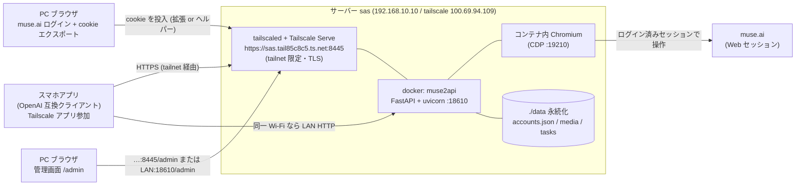

# muse2api サーバー運用 (SAS-Watch / T44)

最終更新: 2026-11-17 / 担当: muse2api-ops (Lead: lead) / タスク: T44 (task-7)

Muse (muse.ai) の Web セッションを OpenAI 互換 API に変換する **muse2api** を、このサーバー上に
**追加費用 0 円 (サーバーの電気代のみ)** でセルフホストし、スマホアプリから使えるようにした記録。

> 結論: **デプロイ・起動・LAN/tailscale 疎通・永続化・API 認証は実測済み**。
> 外出先用の到達経路は **Tailscale Serve (`https://sas.tail85c8c5.ts.net:8445`, tailnet 限定・TLS・0 円)** を採用。
> 公開 Cloudflare トンネル (`muse.sasnews.dev`) は**ユーザー判断で撤回済み** (現在 404)。
> 残る未実施は **Muse アカウントの cookie 投入**のみ (手順は本書)。
> 有料 API・有料サービスは一切使っていない。

---

## 1. 概要

| 項目 | 内容 |
|---|---|
| 目的 | 有料 API を使わず、muse.ai の Web 無料枠を OpenAI 互換 API としてスマホから利用する |
| 採用 | [czg86389-hub/muse2api](https://github.com/czg86389-hub/muse2api) v1.6.11 (MIT) |
| 固定コミット | `19db32a3d6ef50dc87567a8ee0e35dd50c8f7837` (2026-11-16) |
| 配置 | `/home/sasnews/deepseek-harness/default-workspace/services/muse2api` (SAS-Watch リポジトリ外) |
| 起動 | `docker compose up -d --build` (プロジェクト名 `muse2api`, コンテナ `muse2api`) |
| ポート | `0.0.0.0:18610` (LAN 192.168.10.10 / tailscale 100.69.94.109) |
| **スマホ接続 (既定)** | **`https://sas.tail85c8c5.ts.net:8445/v1`** — Tailscale Serve, tailnet 限定・TLS・0 円 (§6) |
| 公開トンネル | `muse.sasnews.dev` は**撤回済み (現在 404)**。§9.2 参照 |
| 認証 | `MUSE2API_KEY` (`m2a_...`) を `Authorization: Bearer` で送る |
| 費用 | 0 円 (既存サーバーのリソースと電気代 + Tailscale Free の範囲) |

### 採用理由 (czg86389-hub/muse2api)

- OpenAI 互換の chat / images / videos、管理画面、複数アカウント、cookie インポート用の
  Chrome 拡張まで一式そろっており、スマホアプリ接続という要件に最短で届く。
- **Dockerfile が単純**: `python:3.11-slim-bookworm` + apt (`chromium ffmpeg fonts-wqy-zenhei
  fonts-freefont-ttf procps curl git ca-certificates`) + `pip install -r requirements.txt`
  (fastapi / uvicorn / pydantic / requests / websocket-client / python-multipart の 6 個)。
  外部スクリプトの取得実行 (`curl | bash` など) や独自バイナリのダウンロードは無い。
- **テレメトリ無し**: ソースを grep して sentry / analytics / mixpanel 等は 0 件。
  外向き通信は (1) muse.ai 本体、(2) GitHub の更新チェック (管理画面を開いた時・読み取りのみ)、
  (3) `api.ipify.org` (アカウント個別プロキシの「接続テスト」を明示実行した時のみ)。
- 比較した [www222fff/muse2api](https://github.com/www222fff/muse2api) (373 stars) は
  mock driver とテストが充実しているが、ブラウザ (CDP) ドライバが未実検証・機能が少なく、
  実運用の主目的 (実アカウントでの chat/画像/動画) に届くまでの距離が長いため不採用。
  mock での起動確認だけなら www222fff が楽だが、czg 版には mock driver が無い (後述)。

---

## 2. 構成



- 現時点の到達経路は **Tailscale Serve (tailnet 限定・HTTPS)** と **LAN (同一 Wi-Fi)**。
  公開 Cloudflare トンネルは撤回済み (§9.2)。Tailscale Serve は既存 tailscaled の機能で追加費用 0 円。
- 通信は tailnet 内 (WireGuard) で暗号化され、TLS 証明書は Tailscale が自動発行 (`*.ts.net`)。
  tailnet に参加していない端末からは解決も接続もできない。

---

## 3. サーバー上のファイル構成

```
/home/sasnews/deepseek-harness/default-workspace/services/muse2api/
├── docker-compose.yml            # 上流のまま (触らない)
├── docker-compose.override.yml   # ローカル上書き (concurrency / 上限 / ログ回転)
├── .env                          # MUSE2API_KEY (600, git 管理外, バックアップ対象)
├── data/                         # 永続化 (コンテナ内 /app/data に bind)
│   ├── accounts.json             # ★ cookie を平文保存 (root 所有 600) — 共有・コミット禁止
│   ├── tasks.json / generation-queue.json
│   ├── media/                    # 生成した画像・動画
│   ├── downloads/ thumbnails/
│   └── accounts.example.json
├── ops/
│   ├── add-tunnel-ingress.sh             # 参考: 公開トンネル追加用 (撤回済み・現在未使用)
│   └── sasnews-tunnel.candidate.yml      # 参考: 上記の検証済み候補 (未使用)
├── extension/                    # cookie インポート用 Chrome 拡張 (管理画面から DL 可)
└── (app.py engine.py admin.html … 上流コード)
```

SAS-Watch リポジトリ側 (git 管理) の追加物:

- `docs/muse2api-server.md` — 本書
- `tools/muse2api/import_cookies.py` — cookie を stdin から受けて安全に投入するヘルパー

---

## 4. 起動・停止・状態確認・更新

すべて配置ディレクトリで実行する (`cd` してから)。

```bash
cd /home/sasnews/deepseek-harness/default-workspace/services/muse2api

# 起動 (初回はビルド込み。2 回目以降は -d のみ)
docker compose up -d --build

# 状態
docker compose ps
docker stats --no-stream muse2api    # メモリ/CPU
curl -s http://127.0.0.1:18610/healthz
curl -s http://127.0.0.1:18610/readyz

# ログ (最大 10MB×3 で回転する設定)
docker compose logs -f --tail 100

# 再起動 / 停止
docker compose restart
docker compose stop
docker compose down          # コンテナ削除 (data/ は残る)
```

### 更新 (手動のみ)

`MUSE2API_MANAGED_DEPLOYMENT=1` にしてあるため、**管理画面の「ワンクリック更新」は無効**
(コンテナ内からの自己書き換えを禁止)。更新は必ず手動で:

```bash
cd /home/sasnews/deepseek-harness/default-workspace/services/muse2api
git pull --ff-only                      # ローカル変更は override/.env/data のみなので衝突しない
docker compose up -d --build
docker compose ps && curl -s http://127.0.0.1:18610/healthz
```

- 更新前に `data/` と `.env` をバックアップする (§12)。
- `docker-compose.yml` は上流のまま。ローカル差分は `docker-compose.override.yml` に閉じている。
- 現在のバージョンは `/admin/status` か `version.json` で確認できる。

### docker-compose.override.yml の内容 (要約)

| 設定 | 値 | 理由 |
|---|---|---|
| `MUSE2API_CONCURRENCY` | 2 | 共用 8core/30GB サーバーで既存サービスを圧迫しない |
| `MUSE2API_MANAGED_DEPLOYMENT` | 1 | コンテナ内自己更新の禁止 (compose 運用) |
| `mem_limit` / `cpus` | 8GiB / 4.0 | dsh-web・cloudflared 等を守る上限 |
| `logging` | json-file 10MB×3 | ログでディスクを埋めない |
| 参考素材の安全設定 | `REF_IMAGE_LOCAL_FILES=0` / `REF_IMAGE_PRIVATE_FETCH=0` | 上流の安全な既定を明示 |

---

## 5. 鍵とセキュリティ

### 5.1 API キー

- `MUSE2API_KEY` は `openssl rand -hex 32` 相当のランダム値 (`m2a_` + 64 hex)。
  **`.env` (mode 600) のみに保存**し、リポジトリ・会話・ログには書かない。
- クライアントは `Authorization: Bearer <MUSE2API_KEY>` を付ける。
- キーを変えたいときは管理画面 (`/admin`) の API キー欄、または
  `POST /admin/apikey/rotate` (要 Bearer) を使い、`.env` も更新して再起動する。
- **キーが空だと認証が無効になる**実装なので、`.env` を消したり空にしないこと。
  (初回起動時に空だと自動生成してログに 1 回だけ表示される。ログを共有しない。)

### 5.2 実測した認証の効き方 (2026-11-17)

| エンドポイント | 認証 | 実測 |
|---|---|---|
| `GET /healthz` `/readyz` | 不要 | 200。稼働状況とアカウント数だけ |
| `GET /v1/models` ほか `/v1/*` | **Bearer 必須** | キー無し 401 / キー有り 200 |
| `GET /admin` `GET /` | 不要 (HTML のみ) | 200。データは返さない |
| `GET /admin/status` `/admin/accounts` `/admin/apikey` ほか | **Bearer 必須** | キー無し 401 |
| `GET /admin/update/check` `GET /admin/repo/status` | **不要 (上流の実装)** | キー無し 200。GitHub へ外向き |
| `GET /v1/media/{name}` | **不要 (上流の実装)** | ファイル名は uuid4 で推測困難だが保護なし |
| `GET /admin/extension` `/admin/cookie-helper` | 不要 | 静的な配布物 (秘密ではない) |
| `POST /admin/repo/push` `/admin/update/upgrade` | Bearer 必須 | — |

**注意点 (到達範囲に応じたリスク)**

現在は **Tailscale Serve (tailnet 限定) + LAN** のみで、インターネットからは到達できない。
ただし tailnet に参加している端末と同一 LAN の端末からは以下が見えるため、
「身内に開放されている」状態であることは理解しておく。将来インターネット公開する場合は
これらがそのまま外部攻撃面になる。

1. `/admin/update/check` と `/admin/repo/status` は**上流コードでは認証が付いていない**。
   誰でも叩くとサーバーから GitHub へリクエストが飛ぶ (バージョン情報が読める / レート制限の踏み台)。
2. `/v1/media/{name}` も認証が無い。生成物の URL を知っていれば誰でも取得できる
   (名前は uuid4 なので総当たりは現実的でないが「URL = 鍵」の状態)。
3. `/admin` の HTML 自体は未認証で配信される。データ/操作 API はキー必須なので
   「画面が見える」だけで、キーが無ければ何も読めない・操作できない。
   **ただし `https://…/admin?key=…` の URL は履歴・Referer・スクショに残るので使わない**
   (画面の入力欄にキーを入れる方が安全。localStorage に保存される)。

### 5.3 公開範囲の考え方

| 経路 | 状態 | 備考 |
|---|---|---|
| **Tailscale Serve** `https://sas.tail85c8c5.ts.net:8445` | **稼働中 (既定)** | tailnet 限定・TLS・0 円。スマホ/PC が tailnet 参加必要 (§9.1) |
| LAN `http://192.168.10.10:18610` | 稼働中 | 同一 Wi-Fi の代替。HTTP なのでキーは平文 → 自宅 LAN 前提 |
| tailscale IP 直 `http://100.69.94.109:18610` | 稼働中 | tailnet 内の代替 (HTTP)。TLS が要るなら Serve を使う |
| Cloudflare Tunnel `https://muse.sasnews.dev` | **撤回済み (404)** | 公開攻撃面を無くすためユーザー判断で撤回 (§9.2) |

現状の評価:

- **インターネットからの攻撃面は無い** (公開 DNS/ingress は撤去済み。`muse.sasnews.dev` は 404)。
- tailnet 限定のため §5.2 の未認証エンドポイント (`/admin/update/check` 等) は
  「tailnet に参加している端末」からしか見えない。ただし tailnet 全端末が管理画面に入れる
  状態ではあるので、**API キーは引き続き必須**。
- 管理画面 (`/admin`) は **PC を tailnet に入れて
  `https://sas.tail85c8c5.ts.net:8445/admin`**、または LAN から
  `http://192.168.10.10:18610/admin`。`/dashboard` は 404 (czg 版) なので注意。
- 将来インターネット公開する場合の防御 (Cloudflare WAF / Access) は **不採用・参考** (§9.2)。
- 有料プラン・有料トンネル・Tailscale Funnel (公開) は使わない (ユーザー条件)。

### 5.4 cookie と個人情報

- Muse の cookie は `data/accounts.json` に**平文**で保存される (root 所有 600)。
  このファイルと `data/` のバックアップは**鍵と同じ機密**として扱う。git に入れない・共有しない。
- `data/` はホストの一般ユーザーから直接読めない (コンテナ root 所有)。バックアップは
  docker 経由で行う (§12)。
- `.env` と `data/` を外部に置かない。クラウドストレージへの自動同期も避ける。

### 5.5 第三者コード実行・非公式ブリッジのリスク

- muse2api は muse.ai の Web UI を**非公式に自動操作する**サードパーティ製 OSS (MIT)。
  公式 API ではないため、Muse 側の UI 変更で動かなくなる可能性がある。
- **Muse の利用規約に抵触し得る**。アカウントの制限・停止・無料枠の変動は自己責任。
- コンテナ内 Chromium は muse.ai の Web コンテンツを実行する。コンテナは docker で隔離され、
  docker.sock やホストのホームはマウントしていない (`./data` のみ) が、ゼロリスクではない。
- 上流コードには「管理画面から自分の GitHub リポジトリへ push する」機能まで存在する。
  本デプロイでは `MUSE2API_MANAGED_DEPLOYMENT=1` + イメージ固定で自己更新を無効化し、
  Git 情報もイメージに含めていない (`has_git: false`)。
- 更新は必ず差分を確認してから手動で (信頼できる版に固定する運用)。

---

## 6. スマホアプリからの接続

### 6.1 OpenAI 互換の設定値

| 項目 | **Tailscale Serve (既定・外出先も可)** | LAN (同一 Wi-Fi の代替) |
|---|---|---|
| Base URL | `https://sas.tail85c8c5.ts.net:8445/v1` | `http://192.168.10.10:18610/v1` |
| API Key | `.env` の `MUSE2API_KEY` | 同じ |
| Model | `muse-spark` (チャット) | 同じ |

前提 (Tailscale Serve):

- スマホ (と管理用 PC) に **Tailscale アプリ**を入れ、**同一 tailnet (`sasshinbun0655@`) に参加**する。
- サーバーの tailnet 名は `sas` (tailnet IP `100.69.94.109`)、MagicDNS は有効
  (`tail85c8c5.ts.net`)。tailnet 内からは `sas.tail85c8c5.ts.net` がそのまま解決される。
- サーバー側は `tailscale serve --bg --https=8445 http://127.0.0.1:18610` で公開済み
  (tailnet 限定・TLS 証明書は自動)。確認・再適用・解除は §9.1。
- 費用は 0 円 (Tailscale Free の範囲)。
- Base URL は `/v1` まで含める (アプリによっては末尾スラッシュ不要)。
- **HTTPS なので「HTTP は不可」というスマホアプリでもそのまま使える** (公開トンネル不要)。
- tailnet 外 (未参加端末) からは解決も接続もできない。これが「公開しない」担保。
- LAN は同一 Wi-Fi 時のみ。HTTP なのでキーは平文で流れる (自宅 LAN 前提)。
- 画像生成は `muse-image`、動画は `muse-video`。`gpt-4o` / `deepseek-chat` などの名前も
  内部で `muse-spark` に寄せられるが、アプリ側は `muse-spark` を選ぶのが確実。
- 多くのアプリは「OpenAI 互換 / カスタム API」設定で Base URL とキーを入れるだけで使える。

### 6.2 curl での疎通確認 (サーバー上)

```bash
KEY=$(sed -n 's/^MUSE2API_KEY=//p' /home/sasnews/deepseek-harness/default-workspace/services/muse2api/.env)

# 認証なし → 401 が正常
curl -s -o /dev/null -w '%{http_code}\n' http://127.0.0.1:18610/v1/models

# 認証あり → モデル一覧
curl -s -H "Authorization: Bearer $KEY" http://127.0.0.1:18610/v1/models

# Tailscale Serve 経由 (サーバー上では *.ts.net の名前解決に失敗することがあるので --resolve を使う)
curl -s --resolve sas.tail85c8c5.ts.net:8445:100.69.94.109 \
  https://sas.tail85c8c5.ts.net:8445/healthz
curl -s -o /dev/null -w '%{http_code}\n' --resolve sas.tail85c8c5.ts.net:8445:100.69.94.109 \
  https://sas.tail85c8c5.ts.net:8445/v1/models      # 401 (キー無し) が正常

# チャット (cookie 投入後)
curl -s http://127.0.0.1:18610/v1/chat/completions \
  -H "Authorization: Bearer $KEY" -H 'Content-Type: application/json' \
  -d '{"model":"muse-spark","messages":[{"role":"user","content":"こんにちは"}],"stream":false}'
```

> アカウント未接続のときのチャットは
> `400 {"error":{"message":"没有可用账号，请先在管理页面导入 cookie"}}` を返す (仕様どおり)。
> サーバー自体の異常ではない。

---

## 7. Muse アカウント接続 (cookie インポート)

muse.ai のログイン状態は cookie (特に `hatch_sess`) で表される。これを muse2api に取り込む。
**必須は `hatch_sess`** (`/admin/status` の `essential_cookies` も `["hatch_sess"]`)。
`hatch_vml` / `hatch_gw` / `hatch_native_auth_device` などはあると良いが、欠けても即「未ログイン」
とは限らない。取り込み後に管理画面で「テスト」して、チャット入力欄が操作できるか確認する。

### 方式 A: Chrome / Edge 拡張 (推奨・コマンド不要)

1. 管理画面 `https://sas.tail85c8c5.ts.net:8445/admin` (PC も tailnet に参加している場合) または
   `http://192.168.10.10:18610/admin` (同一 Wi-Fi) を開き、API キーを入力してログイン。
   **`/dashboard` は 404** なので `/admin` を使う。
2. 「拡張機能」系のボタンから **拡張の zip をダウンロード** する
   (直接の URL は `https://sas.tail85c8c5.ts.net:8445/admin/extension` または
   `http://192.168.10.10:18610/admin/extension`)。
3. 展開して `chrome://extensions` → 右上「デベロッパーモード」ON →
   「パッケージ化されていない拡張機能を読み込む」で展開先フォルダを指定。
   (Edge は `edge://extensions` → 開発者モード)
4. 同じブラウザで https://muse.ai/ にログインし、**チャット画面まで進む**。
5. 拡張のアイコンを開き、**サービス URL** と **API キー**を入力 → 「読み取り/インポート」を実行。
   サービス URL は PC の接続経路に合わせる:
   `https://sas.tail85c8c5.ts.net:8445` (PC も tailnet 参加時・推奨) または
   `http://192.168.10.10:18610` (同一 Wi-Fi 時)。
   無痕 (InPrivate) で使う場合は拡張に「無痕で実行を許可」が必要。
6. 管理画面のアカウント一覧で「テスト」を実行し、セッション有効とチャット操作可否を確認。

> 拡張は上流リポジトリの `extension/` をそのまま zip にしたもの。バージョンは `1.0.3`。
> 上流の更新で拡張も更新されることがある (`version.json` の highlights 参照)。
> サーバーを更新しても拡張は自動更新されないので、必要に応じて管理画面から再取得する。

### 方式 B: DevTools の Cookie ヘッダ + 同梱ヘルパー (コマンド可)

PC の Chrome/Edge で muse.ai にログインし、DevTools で cookie をコピーして、
SAS-Watch 同梱のヘルパー `tools/muse2api/import_cookies.py` で投入する。
**cookie は stdin からだけ受け取る**ので、シェル履歴・`ps`・ログに残らない。

1. muse.ai にログイン → `F12` → **Application (アプリケーション)** →
   **Storage → Cookies → `https://muse.ai`** を開く。
   (`hatch_sess` は HttpOnly だが、この画面には表示される)
2. `hatch_sess` と、あれば `hatch_vml` / `hatch_gw` / `hatch_native_auth_device` /
   `__Host-` で始まるものを含め、muse.ai の cookie を
   `name=value; name2=value2` 形式 (または Network タブの `Cookie:` ヘッダ) でコピーする。
3. ヘルパーを実行して貼り付ける (キーは環境変数 or 非表示プロンプト。値は入力中も表示されない):

```bash
# サーバー上で実行する場合 (キーは .env から読む)
python3 /home/sasnews/deepseek-harness/default-workspace/SAS-Watch/tools/muse2api/import_cookies.py \
  --url http://127.0.0.1:18610 \
  --key-file /home/sasnews/deepseek-harness/default-workspace/services/muse2api/.env \
  --label pc-chrome
# ↑ 実行後に cookie を貼り付けて Ctrl-D (Windows は Ctrl-Z → Enter)

# PC から実行する場合 (Python 3.8+ の標準ライブラリだけで動く)
#   PC が tailnet 参加: --url https://sas.tail85c8c5.ts.net:8445 (推奨)
#   PC が同一 Wi-Fi  : --url http://192.168.10.10:18610
#   Windows PowerShell: $env:MUSE2API_KEY="m2a_..."; python import_cookies.py --url https://sas.tail85c8c5.ts.net:8445
python3 import_cookies.py --url https://sas.tail85c8c5.ts.net:8445
```

- まず `--dry-run` で「cookie が何個読めたか」だけ確認できる (送信しない)。
- 入力は Cookie 文字列のほか、`{"name":"value", ...}` の JSON、
  EditThisCookie 風の `[{"name":…,"value":…,"expirationDate":…}]` も受け付ける。
- 成功時はアカウント ID・個数・`essential_missing` だけを表示する (**cookie の値は表示しない**)。
- 失敗時: 401 = API キー違い / 400 = cookie を解析できず /
  接続失敗 = URL・tailnet 参加 (スマホ/PC の Tailscale が ON か)・LAN/firewall を確認。

> 上流にも PC 用の `tools/get_muse_cookie.py` (Chrome を自動起動して cookie を取る) があるが、
> こちらは API キーをコマンドライン引数で渡す作りなので、履歴に残さないよう
> 環境変数 (`MUSE2API_KEY`) か本ヘルパーを使うこと。

### 7.1 セッションの維持と切れたとき

- 15 分ごとに自動保活 (`/api/session` 確認 + VM ウェイク) が走り、cookie のローテーションを
  保存する。ただし**保活が成功しても永久に持つわけではない**。Muse 側でセッションが
  切られた場合は再インポートが必要。
- 管理画面の「テスト」で `/api/session 401` なら **cookie 再投入** (方式 A か B)。
  `403` は権限・地域・ネットワークの話で、cookie 切れとは限らない (再投入を繰り返さない)。
  `429` / `5xx` / タイムアウトは「今回未確認」であって cookie 失効の証拠ではない。
- Free プランは**週次の利用枠**がある。枠切れは「アカウント異常」ではなく、翌週までの待ち。
  残量は管理画面のアカウント欄で確認できる (取得失敗時は前回値のまま)。

---

## 8. 動作検証の記録 (2026-11-17 実測)

| 項目 | 結果 |
|---|---|
| `docker compose ps` | `muse2api` Up (restart:always) |
| イメージサイズ | 1.69 GB |
| `GET /healthz` | `{"status":"ok",...}` 200 |
| `GET /readyz` | `{"status":"no_account","accounts":0,"browser_running":false}` |
| `GET /v1/models` (キー無し) | 401 |
| `GET /v1/models` (キー有り) | 200 / `muse-spark`, `muse-image`, `muse-video` |
| `GET /admin/status` (キー無し/有り) | 401 / 200 |
| `/admin` ページ | 200 (HTML のみ)。**`/dashboard` は 404** (czg 版は `/admin`) |
| チャット (アカウント無し) | 400 `没有可用账号…` (エラーパスは正常) |
| LAN `http://192.168.10.10:18610/healthz` | 200 |
| tailscale `http://100.69.94.109:18610/healthz` | 200 |
| **Tailscale Serve** `https://sas.tail85c8c5.ts.net:8445/healthz` | 200 (`{"status":"ok",...}`) |
| Tailscale Serve `…/readyz` | `{"status":"no_account","accounts":0,...}` |
| Tailscale Serve `…/v1/models` (キー無し/有り) | 401 / 200 |
| Tailscale Serve `…/admin` | 200 (HTML) |
| `tailscale serve status` | 443/8443/8444/8445 の 4 本。**8445 のみ muse2api**、他は既存サービス (触らない) |
| 公開 `https://muse.sasnews.dev/healthz` | **404 (トンネル撤回済み・正常)** |
| 既存 `https://dsh.sasnews.dev/` | 302 (撤回作業後も無事) |
| tailnet | `sasshinbun0655@` / サーバー `sas` = `100.69.94.109` / MagicDNS `tail85c8c5.ts.net` |
| cookie 投入テスト | ダミー値で `POST /admin/accounts` → 一覧 → `DELETE` まで成功 (実 cookie は未投入) |
| 永続化 | `data/` に marker を置き `docker compose restart` 後も残存、`/v1/models` 200 |
| 自動再起動 | 自然終了 (exit 1) で `RestartCount` 増加を確認。`docker kill` (SIGKILL) は手動停止扱いで再起動しない (Docker 29 の挙動) |
| アイドル負荷 | メモリ 44.8 MiB / CPU 0.1 % (アカウント未接続で Chromium 未起動) |
| ブラウザ起動後 | **未計測** (cookie 投入後に `docker stats` で再計測する。数百 MB を見込む) |
| ホスト再起動時の自動起動 | 未検証 (root 権限なし)。`docker.service` は enabled、コンテナは `restart: always` なので通常は自動で上がる。手動復旧は `docker compose up -d` |
| firewall | **未確認**。`sudo` 不可 (`no_new_privs`)・`ufw` 無し・`nft` は root 必要。LAN 直はスマホ実機での確認が必要 (Tailscale Serve 経由は tailnet なので LAN firewall の影響を受けない) |

> Tailscale Serve の行は 2026-11-17 13:28 頃に `--resolve` で再確認したもの
> (Lead の serve 適用後)。公開トンネル撤回の確認 (`muse` 404 / `dsh` 302) も同時刻。

### 起動ログの見どころ

```
[INFO] 【自动保活守护进程】已启动，检测周期: 15 分钟
[INFO] Uvicorn running on http://0.0.0.0:18610
[WARNING] 【浏览器预热】预热异常: 没有可用账号，请先在管理页面导入 cookie   ← cookie 未投入時は正常
```

---

## 9. 外出先アクセス: Tailscale Serve (採用) と公開トンネル (撤回済み)

### 9.1 Tailscale Serve (採用)

外出先からも使える HTTPS 経路。**tailnet 限定・TLS・追加費用 0 円**。

- サーバー: `sas` (`100.69.94.109`)、tailnet `sasshinbun0655@`、MagicDNS `tail85c8c5.ts.net`
- serve URL (**tailnet 内のみ**): `https://sas.tail85c8c5.ts.net:8445` → `http://127.0.0.1:18610` (muse2api)
- 設定コマンド: `tailscale serve --bg --https=8445 http://127.0.0.1:18610` (**適用済み**)

```bash
# 現在の serve 設定 (tailnet only と表示されれば OK)
tailscale serve status
# https://sas.tail85c8c5.ts.net:8445 (tailnet only)
# |-- / proxy http://127.0.0.1:18610

# 疎通 (サーバー上は *.ts.net の名前解決が失敗することがあるので --resolve を使う)
curl -s --resolve sas.tail85c8c5.ts.net:8445:100.69.94.109 \
  https://sas.tail85c8c5.ts.net:8445/healthz          # {"status":"ok",...}
```

- **注意**: このサーバーでは `tailscaled` の DNS 設定が失敗しており (`/etc/resolv.conf` を
  書き換えられない)、サーバー上から `*.ts.net` を名前解決できないことがある。
  確認は `--resolve` を使う。クライアント (スマホ/PC) 側は MagicDNS で解決できる。
- 同じ `sas.tail85c8c5.ts.net` の **443 / 8443 / 8444 は別サービスが使用中** (8444 は dsh)。
  **8445 以外は触らない**。
- 再適用 (設定が消えた場合): `tailscale serve --bg --https=8445 http://127.0.0.1:18610`
- 解除する場合:
  - `tailscale serve --https=8445 off` (従来構文。この環境の tailscale 1.104 系は
    サブコマンド体系が変わっているため、通らない場合は Tailscale 管理コンソール →
    Machines → `sas` → Serve から 8445 を削除する)
  - **`tailscale serve reset` は 443/8443/8444 も全部消えるので使わない**。
  - 解除後は `tailscale serve status` に 8445 が無いこと、`/healthz` が通らないことを確認。
- 再起動後: `--bg` の serve 設定は tailscaled が保持する。起動後に
  `tailscale serve status` と healthz で確認する。tailscale 自体が down なら `tailscale up`。
- tailnet の ACL でアクセスできる端末/ユーザーを絞ることもできる (Tailscale 管理コンソール)。
  不要な端末を tailnet から外すのが最も効く。

### 9.2 公開 Cloudflare トンネル (撤回済み・参考)

当初は既存 `sasnews-tunnel` に `muse.sasnews.dev → http://localhost:18610` を追加する計画だったが、
**公開インターネットに API/管理画面を出すリスクを避けるため、ユーザー判断で撤回**した。

- 実施済み: `~/.cloudflared/sasnews-tunnel.yml` をバックアップから復元 → ingress validate OK →
  `cloudflared-sasnews.service` 再起動。`https://dsh.sasnews.dev/` は 302 のまま (既存サービス無事)。
- 現在: `https://muse.sasnews.dev/` は **404** (ingress 無し)。DNS の CNAME だけは残っている
  (Cloudflare の IP を返す) が、ingress が無いため到達不能。不要なら Cloudflare ダッシュボードの
  DNS で `muse` を削除する (必須ではない・Lead/ユーザー判断)。
- 復活させる場合の手順は `services/muse2api/ops/add-tunnel-ingress.sh`
  (dry-run / `--apply` / `--rollback`、`cloudflared tunnel ingress validate` 済み) に**参考として残置**。
  ただし公開する場合は §5.3 に書いた防御 (Cloudflare WAF で `/admin*` や `/admin/update*` をブロック等)
  を併用すること。
- 公開時の追加防御として検討した案 (**不採用/参考**):
  - Cloudflare WAF カスタムルールで `muse.sasnews.dev/admin*` をブロックし、管理は LAN/tailnet から。
  - Cloudflare Access (Zero Trust Free, 50 ユーザーまで)。ただし OpenAI 互換アプリは
    `CF-Access-Client-Id/Secret` ヘッダを付けられないことが多く、API 用途とは相性が悪い。
  - 有料プラン・有料トンネル・**Tailscale Funnel (公開)** は使わない (ユーザー条件)。

---

## 10. トラブルシュート

| 症状 | 原因の候補 | 対処 |
|---|---|---|
| スマホから接続できない (Tailscale) | tailnet 未参加 / Tailscale アプリ停止 / 別アカウント | スマホの Tailscale を ON、管理コンソールで端末が tailnet (`sasshinbun0655@`) にいるか確認。サーバー上で `tailscale serve status` と `curl --resolve … /healthz` |
| スマホから接続できない (LAN) | firewall / 別 Wi-Fi / HTTP を弾くアプリ | 自宅 Wi-Fi か確認。サーバー上で `curl -s http://192.168.10.10:18610/healthz`。HTTPS 必須のアプリなら Tailscale Serve を使う |
| `https://sas.tail85c8c5.ts.net:8445` が 502/404 | コンテナ停止 / serve 未設定 | `docker compose ps`、`curl 127.0.0.1:18610/healthz`、`tailscale serve status` (§9.1 の再適用) |
| サーバー上で `sas.tail85c8c5.ts.net` が引けない | tailscaled の DNS 設定失敗 (この環境で発生) | `--resolve sas.tail85c8c5.ts.net:8445:100.69.94.109` を付けて curl。クライアント側は MagicDNS で解決可 |
| `https://muse.sasnews.dev` が 404 | 公開トンネル撤回済み (正常) | 何もしない。使いたい場合のみ §9.2 (非推奨) |
| `/v1/models` が 401 | キー違い・`Bearer` 忘れ | `.env` のキーとアプリ設定を照合 |
| チャットが 400 `没有可用账号` | cookie 未投入 / 全アカウント無効 | §7 で cookie 投入 → 管理画面でテスト |
| アカウントテストが 401 | セッション切れ | cookie 再投入 (§7.1) |
| アカウントテストが 403 | 権限/地域/プラン/ネットワーク | 公式サイトでログイン確認。cookie 再投入を連打しない |
| アカウントテストがタイムアウト/429/5xx | 一時的な上流障害・未確認 | 状態は前回値のまま。時間をおいて再テスト |
| 管理画面が 404 | `/dashboard` を見ている | **`/admin`** を使う (czg 版) |
| 起動直後ログに「预热异常」 | cookie 未投入 | 正常。投入後は消える |
| メモリ使用量が増え続ける | Chromium のタブ/生成物 | 管理画面でタスク/メディア整理、`docker compose restart`。恒常的なら `MUSE2API_CONCURRENCY` を 1 に |
| ポート 18610 が使えない | 別プロセス | `ss -ltnp | grep 18610` |
| ディスクを圧迫 | 生成メディア (`data/media`) | 管理画面で削除。古いものは手動削除可 |

ログに API キーや cookie を出さないこと。問題調査でログを共有するときは
`Authorization` ヘッダ・cookie 値・`/admin?key=` 付き URL を必ず伏せる。

---

## 11. リソースと上限

| 項目 | 実測 / 設定 |
|---|---|
| イメージ | 1.69 GB (Chromium + FFmpeg + fonts 込み) |
| アイドル (cookie 未投入) | メモリ 44.8 MiB / CPU 0.1 % |
| ブラウザ起動後 | 未計測 (数百 MB 想定。`docker stats muse2api` で確認) |
| 上限 | mem_limit 8 GiB / cpus 4.0 (override で設定) / `shm_size 2gb` |
| 同時生成 | `MUSE2API_CONCURRENCY=2` (上流既定は 8。負荷を見て調整) |
| ホスト | 8 core / RAM 30 GiB。実測時点で他サービス使用 13 GiB・空き 3 GiB 前後 |
| ディスク | `/` 468 GB 中 167 GB 使用 (空き 277 GB) |
| ログ | docker json-file 10 MB × 3 で回転。`data/` はメディア分だけ増える |

Tailscale Serve は既存 `tailscaled` の機能で、追加プロセス・追加メモリはほぼ無い
(serve 設定は tailscaled が保持)。負荷増は muse2api 本体 (Chromium) 側で考える。

負荷を上げたいときは `docker-compose.override.yml` の `MUSE2API_CONCURRENCY`/
`mem_limit` を変更して `docker compose up -d`。既存サービス (dsh-web, cloudflared, lifedb) を
圧迫しないよう、まずは現状の上限で運用する。

---

## 12. バックアップとリストア

`data/` はコンテナ root 所有なので、**docker 経由**で取得する (ホストユーザーでは直接読めない)。

```bash
cd /home/sasnews/deepseek-harness/default-workspace/services/muse2api

# バックアップ (cookie を含むので 600 にして厳重管理)
docker compose exec -T muse2api tar czf - -C /app/data . > data-backup-$(date +%Y%m%d).tgz
chmod 600 data-backup-*.tgz
cp -p .env .env.backup-$(date +%Y%m%d) && chmod 600 .env.backup-*

# リストア (サービス停止中に)
docker compose stop
docker compose exec -T muse2api tar xzf - -C /app/data < data-backup-YYYYMMDD.tgz
docker compose start
```

- 更新前・設定変更前には必ず `data/` と `.env` をバックアップ。
- バックアップに cookie (平文) と API キーが入る。クラウド自動同期・共有フォルダに置かない。
- 50 行程度の `accounts.json` + メディアが主な中身。メディアが不要なら
  `accounts.json` `generation-queue.json` だけで十分。

---

## 13. ユーザーにお願いしたいこと (未完了)

1. **スマホを tailnet に参加させて疎通確認**: スマホに Tailscale アプリを入れ
   `sasshinbun0655@` の tailnet に参加 → ブラウザで
   `https://sas.tail85c8c5.ts.net:8445/healthz` を開き `{"status":"ok"...}` を確認。
   (自宅 Wi-Fi なら `http://192.168.10.10:18610/healthz` でも可。firewall は sudo 不可のため未確認)
2. **Muse の cookie 投入** (§7): PC の Chrome/Edge で muse.ai にログインし、拡張 (方式 A)
   または DevTools + ヘルパー (方式 B) で投入。投入先は
   `https://sas.tail85c8c5.ts.net:8445` (PC も tailnet 参加) か `http://192.168.10.10:18610` (同一 Wi-Fi)。
   投入後に管理画面で「テスト」。**cookie の値は会話に書かない**こと。
3. **プランと週次枠の確認**: Free プラン前提。残量と利用可能時間帯を把握しておく。
4. **アプリの Base URL を `https://sas.tail85c8c5.ts.net:8445/v1` に設定**し、スマホから
   実チャットを試す (HTTPS なので HTTP 不可のアプリでも可)。
5. 公開トンネル (`muse.sasnews.dev`) は**撤回済み**。Cloudflare の DNS CNAME が残っているのが
   気になる場合は削除する (任意・Lead/ユーザー判断)。

---

## 14. 免責

- 本構成は **muse.ai の公式 API ではなく、Web UI を自動操作する非公式 OSS (MIT)** を
  セルフホストしたもの。Muse の利用規約・ポリシーに抵触する可能性があり、
  アカウントの制限・停止、無料枠の変更、サービス仕様変更による停止は自己責任。
- 本ドキュメントとセットアップは現状の動作を保証しない (無保証)。商用・共有用途では
  各自で法務・規約を確認すること。
- 費用は 0 円 (既存サーバーの電気代 + Tailscale Free の範囲)。有料 API・有料トンネル・
  Tailscale Funnel (公開) は使用していない。
- 外出先利用は **Tailscale (tailnet/アプリ/アカウント) に依存**する。tailnet の障害・
  アカウント停止・端末の入れ替え時は使えなくなる。
- セキュリティ: API キーと cookie は機密。漏洩時はキーをローテートし、Muse 側でログアウト
  (セッション無効化) して cookie を再取得する。tailnet は「身内ネットワーク」であり、
  参加端末は管理画面に到達できる。端末管理も含めて自己責任。
- 上流リポジトリのコードは第三者のもの。更新は差分確認のうえ自己責任で。

---

## 15. 作業メモ (2026-11-17)

- セットアップ担当: muse2api-ops (Lead: lead)、T44 / task-7。
- サーバー上では `/home/sasnews` が読み取り専用のサンドボックスだったため、配置先を
  `/home/sasnews/services/muse2api` から `default-workspace/services/muse2api` に変更
  (Lead 承認済み・SAS-Watch リポジトリ外なので git 管理外)。
- 未完了: 実 cookie での chat/画像/動画の疎通、ブラウザ起動後のメモリ実測、
  スマホ実機からの tailnet 接続確認、firewall 確認 (root 必要)。
- 参考: 管理画面は `/admin` (`/dashboard` ではない)。`/admin?key=` は使わず画面入力で。

- **2026-11-17 追記 (公開撤回 → Tailscale Serve へ切替)**: ユーザー判断で公開 Cloudflare
  トンネル (`muse.sasnews.dev`) を撤回。`~/.cloudflared/sasnews-tunnel.yml` をバックアップから
  復元 → validate OK → `cloudflared-sasnews.service` 再起動。`dsh.sasnews.dev` 302 維持、
  `muse.sasnews.dev` は 404 (DNS CNAME のみ残存・任意で削除)。
  外出先は **Tailscale Serve `https://sas.tail85c8c5.ts.net:8445` (tailnet 限定・TLS・0 円)** に切替。
  Lead が `tailscale serve --bg --https=8445 http://127.0.0.1:18610` を適用し、
  healthz 200 / `/v1/models` キー無し 401 / キー有り 200 / `/admin` 200 を実測 (2026-11-17 13:2x)。
  本書を Tailscale 前提へ更新 (サーバー/コードの変更は無し、docs のみ)。
